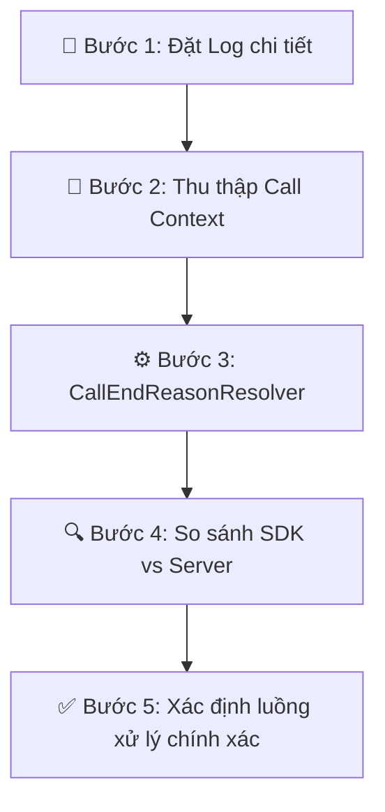
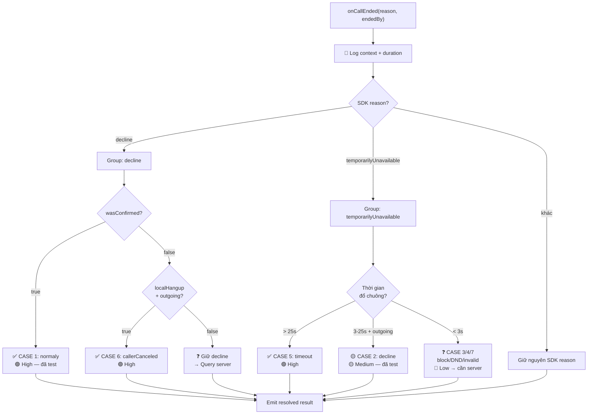
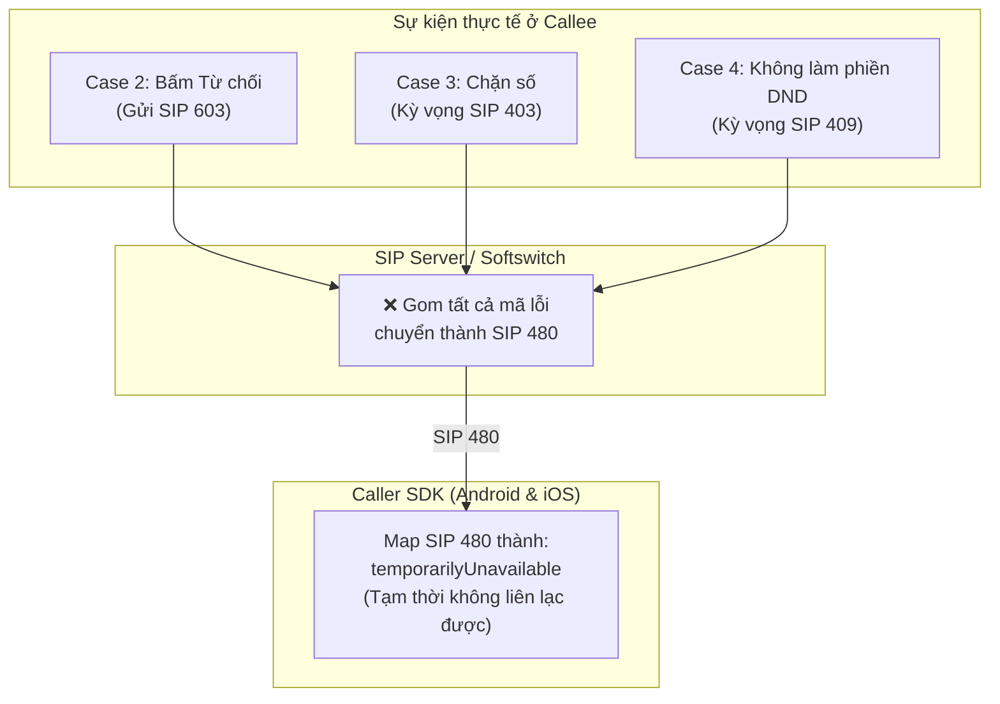

# Hướng Giải Quyết — Call End Reason Mapping

## Tổng Quan Vấn Đề

SDK VBot trả về `VBotEndCallReason` qua callback `onCallEnded(reason, endedBy)`, nhưng giá trị `reason` trả về **không khớp** với kỳ vọng thực tế trong nhiều case.

| # | Usecase | SDK Returned | endedBy | Expected |
|---|---------|-------------|---------|----------|
| 1 | Người nhận đã bắt máy, người gọi kết thúc cuộc gọi | `decline` | `callee` | `normaly` |
| 2 | Người nhận từ chối cuộc gọi | `temporarilyUnavailable` | `carier` | `decline` |
| 3 | Người nhận chặn cuộc gọi | `temporarilyUnavailable` | `carier` | `recipientBlocksCalls` |
| 4 | Người nhận bật chế độ không làm phiền | `temporarilyUnavailable` | `carier` | `doNotDisturb` |
| 5 | Người nhận không nghe máy | `temporarilyUnavailable` | `carier` | `timeout` |
| 6 | Người gọi tắt máy trước khi người nhận bắt máy | `decline` | `callee` | `callerCanceled` |
| 7 | Gọi đến số không tồn tại | `temporarilyUnavailable` | `carier` | `invalidPhoneNumber` |

---

## Chiến Lược Giải Quyết



> [!IMPORTANT]
> Tư duy chính: **Không đoán** → Đặt log → Thu thập dữ liệu thực tế → So sánh SDK result vs Server result → Mới quyết định cách xử lý.

---

## Bước 1 — Đặt Log Chi Tiết Kiểm Tra Nguyên Nhân

### 1.1. Thêm biến tracking vào `MainActivity.companion`

Thêm các biến theo dõi **context cuộc gọi** vào [MainActivity.kt](file:///Users/namhoang/Documents/GitHub/vbot_flutter_example/android/app/src/main/kotlin/com/vpmedia/vbotsdksample/MainActivity.kt#L63-L77):

```kotlin
companion object {
    // ... existing vars ...

    // ═══════════════════════════════════════════════
    // TRACKING CONTEXT — dùng để phân tích call end reason
    // ═══════════════════════════════════════════════
    
    /** Cuộc gọi đã từng đạt trạng thái Confirmed (đã bắt máy) chưa? */
    var wasConfirmed = false
    
    /** Timestamp khi cuộc gọi bắt đầu (Calling/Incoming) */
    var callStartTimestamp: Long = 0
    
    /** Timestamp khi cuộc gọi được confirmed (bắt máy) */
    var callConfirmedTimestamp: Long = 0
    
    /** User local chủ động hangup? */
    var localHangup = false
    
    /** Lưu externalCallId để query server */
    var externalCallId: String = ""
    
    /** Lưu lịch sử trạng thái cuộc gọi */
    var callStateHistory: MutableList<String> = mutableListOf()
}
```

### 1.2. Log tại `onCallState` — ghi lại toàn bộ chuyển đổi trạng thái

Thêm tracking vào [onCallState](file:///Users/namhoang/Documents/GitHub/vbot_flutter_example/android/app/src/main/kotlin/com/vpmedia/vbotsdksample/MainActivity.kt#L166-L226):

```kotlin
override fun onCallState(state: CallState) {
    runOnUiThread {
        val hasActive = if (clientExists()) client.hasActiveCall() else false
        val duration = if (clientExists()) client.getDuration() else null
        
        // ══════ LOG TRACKING ══════
        callStateHistory.add("${state.name}@${System.currentTimeMillis()}")
        Log.d("VBotPhone", "═══════════════════════════════════════")
        Log.d("VBotPhone", "📊 [TRACKING] onCallState: ${state.name}")
        Log.d("VBotPhone", "  ├─ hasActiveCall=$hasActive")
        Log.d("VBotPhone", "  ├─ duration=$duration")
        Log.d("VBotPhone", "  ├─ wasConfirmed=$wasConfirmed")
        Log.d("VBotPhone", "  ├─ isIncoming=$isIncoming")
        Log.d("VBotPhone", "  ├─ localHangup=$localHangup")
        Log.d("VBotPhone", "  └─ history=${callStateHistory.joinToString(" → ")}")
        Log.d("VBotPhone", "═══════════════════════════════════════")
        
        currentCallState = when (state) {
            CallState.Null -> {
                isIncoming = false
                "none"
            }
            CallState.Calling, CallState.Early -> {
                isIncoming = false
                // ══ TRACKING: ghi timestamp bắt đầu gọi ══
                if (callStartTimestamp == 0L) {
                    callStartTimestamp = System.currentTimeMillis()
                    Log.d("VBotPhone", "⏱️ [TRACKING] Call started at: $callStartTimestamp")
                }
                "calling"
            }
            CallState.Incoming -> {
                isIncoming = true
                // ══ TRACKING: ghi timestamp nhận cuộc gọi ══
                if (callStartTimestamp == 0L) {
                    callStartTimestamp = System.currentTimeMillis()
                    Log.d("VBotPhone", "⏱️ [TRACKING] Incoming call at: $callStartTimestamp")
                }
                // ... existing incoming logic ...
                "incoming"
            }
            CallState.Connecting -> "connecting"
            CallState.Confirmed -> {
                // ══ TRACKING: đánh dấu đã bắt máy ══
                wasConfirmed = true
                callConfirmedTimestamp = System.currentTimeMillis()
                Log.d("VBotPhone", "✅ [TRACKING] Call CONFIRMED at: $callConfirmedTimestamp")
                Log.d("VBotPhone", "  └─ Ring duration: ${callConfirmedTimestamp - callStartTimestamp}ms")
                // ... existing confirmed logic ...
                "confirmed"
            }
            else -> {
                // Disconnected
                isMute = false
                isSpeaker = false
                OngoingCallNotification.cancel(applicationContext)
                "disconnected"
            }
        }
        
        // ... existing emit logic ...
        
        if (state == CallState.Disconnected || state == CallState.Null) {
            // KHÔNG reset tracking vars ở đây — 
            // để onCallEnded dùng xong mới reset
            isIncoming = false
            nameCall = ""
            currentCallState = "none"
        }
    }
}
```

### 1.3. Log tại `onCallEnded` — nơi SDK trả kết quả

Thêm log chi tiết vào [onCallEnded](file:///Users/namhoang/Documents/GitHub/vbot_flutter_example/android/app/src/main/kotlin/com/vpmedia/vbotsdksample/MainActivity.kt#L228-L244):

```kotlin
override fun onCallEnded(reason: VBotEndCallReason, endedBy: VBotCallEndParty) {
    runOnUiThread {
        val now = System.currentTimeMillis()
        val totalDuration = now - callStartTimestamp
        val confirmedDuration = if (wasConfirmed) now - callConfirmedTimestamp else 0

        // ══════════════════════════════════════════════════════
        // LOG TOÀN BỘ CONTEXT ĐỂ KIỂM TRA NGUYÊN NHÂN
        // ══════════════════════════════════════════════════════
        Log.d("VBotPhone", "🔴🔴🔴 ═══════════════════════════════════")
        Log.d("VBotPhone", "🔴 [onCallEnded] CALL ENDED — RAW DATA:")
        Log.d("VBotPhone", "  ├─ SDK reason     : ${reason.name}")
        Log.d("VBotPhone", "  ├─ SDK endedBy    : ${endedBy.name}")
        Log.d("VBotPhone", "  ├─ wasConfirmed   : $wasConfirmed")
        Log.d("VBotPhone", "  ├─ localHangup    : $localHangup")
        Log.d("VBotPhone", "  ├─ isIncoming     : $isIncoming")
        Log.d("VBotPhone", "  ├─ totalDuration  : ${totalDuration}ms")
        Log.d("VBotPhone", "  ├─ confirmedDur   : ${confirmedDuration}ms")
        Log.d("VBotPhone", "  ├─ externalCallId : $externalCallId")
        Log.d("VBotPhone", "  └─ stateHistory   : ${callStateHistory.joinToString(" → ")}")
        Log.d("VBotPhone", "🔴🔴🔴 ═══════════════════════════════════")

        // ══════════════════════════════════════════════════════
        // GỌI RESOLVER — hàm cuối cùng trả kết quả
        // ══════════════════════════════════════════════════════
        val context = CallEndContext(
            sdkReason = reason,
            sdkEndedBy = endedBy,
            wasConfirmed = wasConfirmed,
            localHangup = localHangup,
            isIncoming = isIncoming,
            totalDurationMs = totalDuration,
            confirmedDurationMs = confirmedDuration,
            callStateHistory = callStateHistory.toList(),
            externalCallId = externalCallId,
        )
        val resolved = CallEndReasonResolver.resolve(context)

        Log.d("VBotPhone", "🟢 [RESOLVED] SDK: ${reason.name} → App: ${resolved.reason.name}")
        Log.d("VBotPhone", "  ├─ endedBy: ${endedBy.name} → ${resolved.endedBy.name}")
        Log.d("VBotPhone", "  └─ confidence: ${resolved.confidence}")

        // Emit kết quả đã resolve
        val reasonVi = getEndReasonVietnamese(resolved.reason)
        val callSink = CallSink(
            name = nameCall,
            state = "disconnected",
            isIncoming = isIncoming,
            isMute = isMute,
            onHold = onHold,
            endedReason = resolved.reason.name,
            endedBy = resolved.endedBy.name,
            message = buildString {
                append("🔴 [onCallEnded] $reasonVi (${resolved.reason.name})")
                append(", Kết thúc bởi: ${resolved.endedBy.name}")
                append("\n📊 SDK gốc: reason=${reason.name}, endedBy=${endedBy.name}")
                append("\n🔄 Resolver: ${resolved.reason.name} (${resolved.confidence})")
                if (resolved.reason != reason) {
                    append("\n⚠️ ĐÃ ĐIỀU CHỈNH: ${reason.name} → ${resolved.reason.name}")
                }
            }
        )
        events?.success(callSink.toMap())

        // ══ RESET tracking vars sau khi đã dùng xong ══
        resetCallTracking()
    }
}
```

### 1.4. Log tại `hangUp` — đánh dấu local hangup

Cập nhật [hangUp](file:///Users/namhoang/Documents/GitHub/vbot_flutter_example/android/app/src/main/kotlin/com/vpmedia/vbotsdksample/MainActivity.kt#L647-L661):

```kotlin
private fun hangUp(call: MethodCall) {
    // ══ TRACKING: đánh dấu user chủ động gác máy ══
    localHangup = true
    Log.d("VBotPhone", "📞 [TRACKING] localHangup=true, wasConfirmed=$wasConfirmed, isIncoming=$isIncoming")
    
    val hasCall = if (clientExists()) client.hasActiveCall() else false
    // ... existing logic ...
    client.endCall()
    resultWrapper?.success(null)
}
```

### 1.5. Log tại `onExternalCallId` — lưu ID để query server

Cập nhật [onExternalCallId](file:///Users/namhoang/Documents/GitHub/vbot_flutter_example/android/app/src/main/kotlin/com/vpmedia/vbotsdksample/MainActivity.kt#L264-L277):

```kotlin
override fun onExternalCallId(externalCallId: String) {
    Log.d("VBotPhone", "🆔 [TRACKING] externalCallId: $externalCallId")
    // ══ TRACKING: lưu ID để so sánh với server ══
    MainActivity.externalCallId = externalCallId
    // ... existing logic ...
}
```

### 1.6. Hàm reset tracking

```kotlin
companion object {
    // ... existing code ...
    
    fun resetCallTracking() {
        Log.d("VBotPhone", "🔄 [TRACKING] Reset all tracking vars")
        wasConfirmed = false
        callStartTimestamp = 0
        callConfirmedTimestamp = 0
        localHangup = false
        externalCallId = ""
        callStateHistory.clear()
    }
}
```

---

## Bước 2 — CallEndContext & CallEndReasonResolver

### 2.1. Data class `CallEndContext` — chứa toàn bộ context

```kotlin
/**
 * Chứa toàn bộ ngữ cảnh tại thời điểm cuộc gọi kết thúc.
 * Được truyền vào Resolver để quyết định reason cuối cùng.
 */
data class CallEndContext(
    /** Reason gốc SDK trả về */
    val sdkReason: VBotEndCallReason,
    /** EndedBy gốc SDK trả về */
    val sdkEndedBy: VBotCallEndParty,
    /** Cuộc gọi đã từng ở trạng thái Confirmed? */
    val wasConfirmed: Boolean,
    /** User local chủ động gọi hangup()? */
    val localHangup: Boolean,
    /** Đây là cuộc gọi đến? */
    val isIncoming: Boolean,
    /** Tổng thời gian từ lúc bắt đầu gọi đến khi kết thúc (ms) */
    val totalDurationMs: Long,
    /** Thời gian đàm thoại sau khi confirmed (ms), 0 nếu chưa confirmed */
    val confirmedDurationMs: Long,
    /** Lịch sử các trạng thái cuộc gọi */
    val callStateHistory: List<String>,
    /** External Call ID để query server */
    val externalCallId: String,
)
```

### 2.2. Data class `ResolvedCallEnd` — kết quả đã phân tích

```kotlin
/**
 * Kết quả cuối cùng sau khi Resolver phân tích.
 */
data class ResolvedCallEnd(
    /** Reason đã được điều chỉnh (có thể khác SDK gốc) */
    val reason: VBotEndCallReason,
    /** EndedBy đã được điều chỉnh */
    val endedBy: VBotCallEndParty,
    /** Mức độ tin cậy của kết quả */
    val confidence: String, // "high", "medium", "low", "sdk_original"
    /** Giải thích tại sao điều chỉnh */
    val explanation: String,
)
```

### 2.3. `CallEndReasonResolver` — hàm cuối cùng trả kết quả

```kotlin
/**
 * Hàm cuối cùng nhận toàn bộ context và trả về kết quả đã điều chỉnh.
 * 
 * Logic:
 * 1. Nhận reason + endedBy gốc từ SDK
 * 2. Kết hợp với context (wasConfirmed, localHangup, duration, ...)
 * 3. Trả về reason chính xác hơn + mức độ tin cậy
 * 4. Log để so sánh với server
 */
object CallEndReasonResolver {

    fun resolve(ctx: CallEndContext): ResolvedCallEnd {
        Log.d("VBotResolver", "════════════════════════════════════")
        Log.d("VBotResolver", "🧮 RESOLVING: sdk=${ctx.sdkReason.name}, endedBy=${ctx.sdkEndedBy.name}")
        Log.d("VBotResolver", "  wasConfirmed=${ctx.wasConfirmed}, localHangup=${ctx.localHangup}")
        Log.d("VBotResolver", "  isIncoming=${ctx.isIncoming}, totalDur=${ctx.totalDurationMs}ms")
        Log.d("VBotResolver", "════════════════════════════════════")

        val result = when (ctx.sdkReason) {
            // ══════════════════════════════════════════
            // GROUP 1: SDK trả "decline" 
            // Cần phân biệt: normaly vs callerCanceled
            // ══════════════════════════════════════════
            VBotEndCallReason.decline -> resolveDecline(ctx)

            // ══════════════════════════════════════════
            // GROUP 2: SDK trả "temporarilyUnavailable"
            // Cần phân biệt: decline vs recipientBlocksCalls 
            //                 vs doNotDisturb vs timeout 
            //                 vs invalidPhoneNumber
            // ══════════════════════════════════════════
            VBotEndCallReason.temporarilyUnavailable -> resolveTemporarilyUnavailable(ctx)

            // ══════════════════════════════════════════
            // Các reason khác: giữ nguyên SDK
            // ══════════════════════════════════════════
            else -> ResolvedCallEnd(
                reason = ctx.sdkReason,
                endedBy = ctx.sdkEndedBy,
                confidence = "sdk_original",
                explanation = "SDK reason không cần điều chỉnh"
            )
        }

        Log.d("VBotResolver", "🟢 RESULT: ${ctx.sdkReason.name} → ${result.reason.name} (${result.confidence})")
        Log.d("VBotResolver", "  └─ ${result.explanation}")
        return result
    }

    // ─────────────────────────────────────────────
    // GROUP 1: Xử lý khi SDK trả "decline"
    // ─────────────────────────────────────────────

    private fun resolveDecline(ctx: CallEndContext): ResolvedCallEnd {
        Log.d("VBotResolver", "📋 resolveDecline:")
        Log.d("VBotResolver", "  wasConfirmed=${ctx.wasConfirmed}, localHangup=${ctx.localHangup}")

        // CASE 1: Đã bắt máy (confirmed) rồi mới kết thúc → normaly
        if (ctx.wasConfirmed) {
            Log.d("VBotResolver", "  → CASE 1: wasConfirmed=true → normaly")
            return ResolvedCallEnd(
                reason = VBotEndCallReason.normaly,
                endedBy = ctx.sdkEndedBy,
                confidence = "high",
                explanation = "CASE 1: Cuộc gọi đã confirmed (bắt máy) rồi kết thúc → kết thúc bình thường"
            )
        }

        // CASE 6: Người gọi tự hủy trước khi bắt máy → callerCanceled
        if (ctx.localHangup && !ctx.wasConfirmed && !ctx.isIncoming) {
            Log.d("VBotResolver", "  → CASE 6: localHangup + chưa confirmed + outgoing → callerCanceled")
            return ResolvedCallEnd(
                reason = VBotEndCallReason.callerCanceled,
                endedBy = VBotCallEndParty.caller,  // Fix: caller, không phải callee
                confidence = "high",
                explanation = "CASE 6: Người gọi chủ động hủy (localHangup) trước khi bắt máy"
            )
        }

        // Không match case nào → giữ nguyên, cần thêm dữ liệu
        Log.d("VBotResolver", "  → UNKNOWN: giữ decline, cần thêm dữ liệu server")
        return ResolvedCallEnd(
            reason = VBotEndCallReason.decline,
            endedBy = ctx.sdkEndedBy,
            confidence = "low",
            explanation = "decline chưa match case nào → cần so sánh với server"
        )
    }

    // ─────────────────────────────────────────────
    // GROUP 2: Xử lý khi SDK trả "temporarilyUnavailable"
    // ─────────────────────────────────────────────

    private fun resolveTemporarilyUnavailable(ctx: CallEndContext): ResolvedCallEnd {
        val ringDurationSec = ctx.totalDurationMs / 1000

        Log.d("VBotResolver", "📋 resolveTemporarilyUnavailable:")
        Log.d("VBotResolver", "  totalDur=${ctx.totalDurationMs}ms (${ringDurationSec}s)")
        Log.d("VBotResolver", "  isIncoming=${ctx.isIncoming}, wasConfirmed=${ctx.wasConfirmed}")

        // CASE 5: Đổ chuông > 25 giây + chưa bắt máy → timeout
        if (ringDurationSec > 25 && !ctx.wasConfirmed) {
            Log.d("VBotResolver", "  → CASE 5: ring ${ringDurationSec}s > 25s → timeout")
            return ResolvedCallEnd(
                reason = VBotEndCallReason.timeOut,
                endedBy = ctx.sdkEndedBy,
                confidence = "high",
                explanation = "CASE 5: Đổ chuông ${ringDurationSec}s (>25s), chưa bắt máy → timeout"
            )
        }

        // CASE 2/3/4/7: Phản hồi nhanh (< 25s) — cần thêm dữ liệu server
        // Tạm thời log chi tiết để phân tích
        Log.d("VBotResolver", "  → AMBIGUOUS: ring ${ringDurationSec}s (<25s)")
        Log.d("VBotResolver", "    Có thể là: decline / recipientBlocksCalls / doNotDisturb / invalidPhoneNumber")
        Log.d("VBotResolver", "    → CẦN SO SÁNH VỚI SERVER qua externalCallId=${ctx.externalCallId}")

        // Heuristic sơ bộ (cần xác nhận bằng dữ liệu server):
        // - < 3 giây: có khả năng block/DND/invalidPhone 
        // - 3-25 giây: có khả năng decline (người nhận nhìn thấy rồi reject)
        val heuristicReason = if (ringDurationSec < 3) {
            Log.d("VBotResolver", "    Heuristic: <3s → khả năng block/DND/invalid (cần server xác nhận)")
            // Không đoán cụ thể, giữ nguyên + đánh dấu cần server verify
            VBotEndCallReason.temporarilyUnavailable
        } else {
            Log.d("VBotResolver", "    Heuristic: 3-25s → khả năng decline (cần server xác nhận)")
            // Khả năng cao là decline nhưng chưa chắc chắn
            VBotEndCallReason.temporarilyUnavailable
        }

        return ResolvedCallEnd(
            reason = heuristicReason,
            endedBy = ctx.sdkEndedBy,
            confidence = "low",
            explanation = "temporarilyUnavailable: ring ${ringDurationSec}s → CHƯA XÁC ĐỊNH, cần server data (externalCallId=${ctx.externalCallId})"
        )
    }
}
```

---

## Bước 3 — So Sánh SDK vs Server

### 3.1. Tại sao cần so sánh?

SDK chỉ có thông tin **SIP level** (giới hạn). Server VBot có thông tin **nghiệp vụ** (chính xác hơn):

```
┌──────────────┐          ┌──────────────┐
│  SDK (SIP)   │          │ VBot Server  │
│              │          │              │
│ decline      │    vs    │ normaly      │  ← Server biết cuộc gọi đã connected
│ tempUnavail  │    vs    │ decline      │  ← Server biết callee reject
│ tempUnavail  │    vs    │ timeout      │  ← Server biết ring timeout
│ tempUnavail  │    vs    │ invalid      │  ← Server biết số không tồn tại
└──────────────┘          └──────────────┘
```

### 3.2. Hàm lấy kết quả server và so sánh

```kotlin
/**
 * Gọi API lịch sử cuộc gọi VBot để lấy kết quả server,
 * rồi log so sánh với kết quả SDK và Resolver.
 * 
 * Chạy async, không block UI.
 * Mục đích: thu thập dữ liệu để tinh chỉnh Resolver.
 */
object CallEndServerComparator {
    
    /**
     * So sánh kết quả sau khi cuộc gọi kết thúc.
     * Gọi hàm này SAU khi onCallEnded đã emit xong.
     */
    fun compareWithServer(
        externalCallId: String,
        sdkReason: VBotEndCallReason,
        resolvedReason: VBotEndCallReason,
        resolvedConfidence: String,
    ) {
        if (externalCallId.isEmpty()) {
            Log.w("VBotCompare", "⚠️ Không có externalCallId → không thể query server")
            return
        }

        CoroutineScope(Dispatchers.IO).launch {
            try {
                // TODO: Gọi API VBot để lấy thông tin cuộc gọi
                // val serverResult = vbotApi.getCallHistory(externalCallId)
                // val serverReason = serverResult.endReason
                // val serverEndedBy = serverResult.endedBy
                
                // ══════════════════════════════════════════════════════
                // LOG SO SÁNH 3 CHIỀU: SDK vs Resolver vs Server
                // ══════════════════════════════════════════════════════
                // Log.d("VBotCompare", "╔═══════════════════════════════════════╗")
                // Log.d("VBotCompare", "║  SO SÁNH KẾT QUẢ — $externalCallId")
                // Log.d("VBotCompare", "╠═══════════════════════════════════════╣")
                // Log.d("VBotCompare", "║ SDK raw     : ${sdkReason.name}")
                // Log.d("VBotCompare", "║ Resolver    : ${resolvedReason.name} ($resolvedConfidence)")
                // Log.d("VBotCompare", "║ Server      : ${serverReason}")
                // Log.d("VBotCompare", "╠═══════════════════════════════════════╣")
                //
                // val sdkCorrect = sdkReason.name == serverReason
                // val resolverCorrect = resolvedReason.name == serverReason
                //
                // Log.d("VBotCompare", "║ SDK đúng?     : ${if (sdkCorrect) "✅" else "❌"}")
                // Log.d("VBotCompare", "║ Resolver đúng? : ${if (resolverCorrect) "✅" else "❌"}")
                //
                // if (!resolverCorrect) {
                //     Log.w("VBotCompare", "║ ⚠️ RESOLVER SAI! Cần cập nhật logic")
                //     Log.w("VBotCompare", "║    Expected: $serverReason")
                //     Log.w("VBotCompare", "║    Got:      ${resolvedReason.name}")
                // }
                //
                // Log.d("VBotCompare", "╚═══════════════════════════════════════╝")
                
                Log.d("VBotCompare", "TODO: Implement API call to get server result for $externalCallId")

            } catch (e: Exception) {
                Log.e("VBotCompare", "Error comparing with server: ${e.message}")
            }
        }
    }
}
```

### 3.3. Gọi compareWithServer sau onCallEnded

Thêm vào cuối `onCallEnded`, **sau khi emit callSink**:

```kotlin
// Sau events?.success(callSink.toMap())...

// ══ So sánh async với server ══
CallEndServerComparator.compareWithServer(
    externalCallId = ctx.externalCallId,
    sdkReason = ctx.sdkReason,
    resolvedReason = resolved.reason,
    resolvedConfidence = resolved.confidence,
)
```

---

## Bước 4 — Phân Tích Từng Case: Tín Hiệu Nhận Biết

### Bảng quyết định cho Resolver (đã cập nhật sau test Case 2)

| Điều kiện | Kết luận | Confidence | Đã test? |
|-----------|----------|------------|----------|
| `decline` + `wasConfirmed=true` | → `normaly` | 🟢 High | ✅ Case 1 |
| `decline` + `localHangup=true` + `!wasConfirmed` + `!isIncoming` | → `callerCanceled` | 🟢 High | ⏳ Case 6 |
| `temporarilyUnavailable` + `> 25s` + `!wasConfirmed` | → `timeout` | 🟢 High | ⏳ Case 5 |
| `temporarilyUnavailable` + `3-25s` + `outgoing` + `!wasConfirmed` | → `decline` | 🟡 Medium | ✅ Case 2 |
| `temporarilyUnavailable` + `< 3s` + `!wasConfirmed` | → giữ nguyên (block/DND/invalid) | 🔴 Low | ⏳ Case 3/4/7 |

### Mermaid — Luồng xử lý tổng thể



---

## Bước 5 — Quy Trình Thu Thập Dữ Liệu & Tinh Chỉnh

### Phase 1: Thu thập (Tuần 1-2)

1. Deploy code có đầy đủ log tracking + resolver
2. Chạy test **từng case** trong bảng:
   - Gọi → để bắt máy → gác máy → ghi log
   - Gọi → để reject → ghi log
   - Gọi → để hết chuông → ghi log
   - ...
3. Với mỗi lần test, **ghi lại**:

```
| Lần | Usecase            | SDK reason             | SDK endedBy | Resolver reason | Server reason | totalDuration | Match? |
|-----|--------------------|------------------------|-------------|-----------------|---------------|---------------|--------|
| 1   | Bắt máy rồi gác   | decline                | callee      | normaly         | ???           | 45000ms       | ???    |
| 2   | Không nghe máy     | temporarilyUnavailable | carier      | timeout         | ???           | 32000ms       | ???    |
```

### Phase 2: Phân tích (Tuần 2-3)

So sánh **Resolver reason** vs **Server reason**:
- Nếu khớp → Resolver logic đúng ✅
- Nếu không khớp → Cần thêm tín hiệu phân biệt

### Phase 3: Tinh chỉnh (Tuần 3+)

Dựa trên dữ liệu thực tế, cập nhật `resolveTemporarilyUnavailable()`:

```kotlin
// Sau khi có dữ liệu server, có thể thêm logic:
private fun resolveTemporarilyUnavailable(ctx: CallEndContext): ResolvedCallEnd {
    val ringDurationSec = ctx.totalDurationMs / 1000

    // Pattern đã xác nhận bởi server data:
    return when {
        // Timeout: > 25s (đã xác nhận bởi server)
        ringDurationSec > 25 && !ctx.wasConfirmed -> ResolvedCallEnd(
            reason = VBotEndCallReason.timeOut,
            endedBy = ctx.sdkEndedBy,
            confidence = "high",
            explanation = "Timeout: ${ringDurationSec}s > 25s"
        )
        
        // TODO: Thêm pattern sau khi có dữ liệu server
        // Ví dụ sau khi thu thập:
        // - Block thường < 2s
        // - DND thường < 1s  
        // - Decline thường 3-15s
        // - InvalidPhone thường < 5s
        
        else -> ResolvedCallEnd(
            reason = VBotEndCallReason.temporarilyUnavailable,
            endedBy = ctx.sdkEndedBy,
            confidence = "low",
            explanation = "Chưa đủ pattern, ring=${ringDurationSec}s"
        )
    }
}
```

---

## Tóm Tắt

| Bước | Mô tả | File thay đổi |
|------|--------|----------------|
| 1 | Thêm tracking vars + log chi tiết | `MainActivity.kt` (companion) |
| 2 | Tạo `CallEndContext` + `ResolvedCallEnd` | File mới hoặc cùng file |
| 3 | Tạo `CallEndReasonResolver.resolve()` | File mới hoặc cùng file |
| 4 | Tạo `CallEndServerComparator` | File mới hoặc cùng file |
| 5 | Gọi resolver + comparator trong `onCallEnded` | `MainActivity.kt` |
| 6 | Thu thập dữ liệu → tinh chỉnh resolver | Ongoing |

> [!TIP]
> **3 case có thể fix ngay** (high confidence): Case 1 (`normaly`), Case 5 (`timeout`), Case 6 (`callerCanceled`).
> **4 case cần dữ liệu server**: Case 2, 3, 4, 7 — tất cả đều là `temporarilyUnavailable` với thời gian ngắn → cần server xác nhận pattern.

---

## Kết Quả Test Thực Tế

### Bảng tổng hợp kết quả

| # | Case | Trạng thái | Android SDK | iOS SDK | Server | Khớp? |
|---|------|------------|-------------|---------|--------|-------|
| 1 | Người nhận nghe máy → Người gọi tắt máy | ✅ Đã test | `normaly` / `caller` | `normal` / `Caller ended the call` | `normaly` | ✅ Khớp |
| 2 | Người nhận từ chối cuộc gọi | ✅ Đã test | Nhận: `decline`/`callee` ✅ — Gọi: `temporarilyUnavailable`/`carrier` ❌ | `temporarily_unavailable` / `carrier` ❌ | `decline` | ✅ Nhận / ❌ Gọi (Server gửi 480) |
| 3 | Người nhận chặn cuộc gọi | ⏳ Sẵn sàng test | Đã đặt log & tracking | Đã đặt log & tracking | `recipientBlocksCalls` | — |
| 4 | Người nhận bật không làm phiền | ❌ Đã test (Cả 2) | `temporarilyUnavailable` / `carrier` (1.7s) ❌ | `temporarily_unavailable` / `carrier` (2.8s) ❌ | `doNotDisturb` | ❌ Sai do Server gửi SIP 480 |
| 5 | Người nhận không nghe máy | ✅ Đã test (Cả 2) | `temporarilyUnavailable` (31s) → ✅ Resolved `timeOut` | `temporarily_unavailable` (32.8s) → ✅ Resolved `timeOut` | `timeOut` | ⚠️ SDK trả 480, Resolver sửa đúng |
| 6 | Người gọi tắt trước khi bắt máy | ✅ Đã test (Cả 2) | `decline` (1.9s) → ✅ Resolved `callerCanceled` | `normal` (3.3s) → ✅ Resolved `callerCanceled` | `callerCanceled` | ⚠️ SDK sai, Resolver sửa đúng |
| 7 | Gọi đến số không tồn tại | ❌ Đã test (Cả 2) | `temporarilyUnavailable` (380ms) ❌ | `temporarily_unavailable` (2.0s) ❌ | `invalidPhoneNumber` / `destinationNotFound` | ❌ Sai do Server gửi SIP 480 |

---

### ✅ Case 1: Người nhận nghe máy → Người gọi tắt máy

**Mô tả**: Hai bên thiết lập cuộc gọi thành công (đã sang trạng thái `Confirmed`), sau đó người gọi (Caller) chủ động cúp máy.

#### Hàm SDK trả kết quả

| Platform | Hàm trả kết quả ⭐ | File | Overload |
|----------|---------------------|------|----------|
| **Android** | `onCallEnded(reason: VBotEndCallReason, endedBy: VBotCallEndParty)` | [MainActivity.kt:294](file:///Users/namhoang/Documents/GitHub/vbot_flutter_example/android/app/src/main/kotlin/com/vpmedia/vbotsdksample/MainActivity.kt#L294) | 2 tham số |
| **iOS** | `callEnded(reason: VBotEndCallReason, endedBy: VBotCallEndParty)` | [AppDelegate.swift:229](file:///Users/namhoang/Documents/GitHub/vbot_flutter_example/ios/Runner/AppDelegate.swift#L229) | 2 tham số |

> [!IMPORTANT]
> Hàm `onCallState(Disconnected)` / `callState(disconnected)` **KHÔNG** phải hàm trả kết quả. Nó chỉ báo trạng thái disconnected mà **không có** `endedReason` và `endedBy`.

---

#### 1. Kết quả test phía NGƯỜI GỌI (Caller chủ động cúp máy) ⭐

Đây là trọng tâm của Case 1: App VBot SDK đóng vai trò là bên gọi đi và bấm nút tắt máy sau khi người nhận đã bắt máy.

##### iOS — Log thực tế (Người gọi cúp máy)

```
CXStartCallAction → Cuộc gọi đi: calling → early → connecting → confirmed
✅ [TRACKING] Call CONFIRMED, ring duration: 4.9s
📞 [TRACKING] localHangup=true, wasConfirmed=true
CXEndCallAction → Cuộc gọi đi: disconnected
🔴🔴🔴═══════════════════════════════════════
🔴 [CALLBACK #6] callEnded(reason, endedBy)
  ├─ reason       : normal (rawValue: 1000)
  ├─ endedBy      : Caller ended the call (rawValue: 0)
  ├─ description  : Call ended
  ├─ wasConfirmed : true
  ├─ localHangup  : true
  ├─ totalDuration: 12.6s
  ├─ confirmedDur : 7.7s
  └─ stateHistory : calling → early → connecting → confirmed → disconnected
🔴🔴🔴═══════════════════════════════════════
🟢 [RESOLVED] KẾT QUẢ CUỐI CÙNG:
  ├─ reason=normal, endedBy=Caller ended the call
```
👉 **iOS SDK**: Trả về **chính xác 100%** không cần sửa.

##### Android — Log thực tế (Người gọi cúp máy)

```
onCallState: Calling → Early → Connecting → Confirmed
✅ [TRACKING] Call CONFIRMED at: 1788927719238 (Ring duration: 5394ms)
🔴 Native hangUp() called, hasActiveCall=true, currentCallState=confirmed
📞 [TRACKING] localHangup=true, wasConfirmed=true
🔴🔴🔴═══════════════════════════════════════
🔴 [CALLBACK #7] onCallEnded(reason, endedBy)
🔴 ⭐ ĐÂY LÀ HÀM TRẢ KẾT QUẢ (có endedReason + endedBy)
  ├─ SDK reason     : decline          <-- ❌ SDK GỐC TRẢ SAI
  ├─ SDK endedBy    : callee           <-- ❌ SDK GỐC TRẢ SAI
  ├─ wasConfirmed   : true
  ├─ localHangup    : true
  ├─ totalDuration  : 7952ms (7s)
  ├─ confirmedDur   : 2558ms
🔴🔴🔴═══════════════════════════════════════
🟢 [RESOLVED] KẾT QUẢ CUỐI CÙNG:
  ├─ SDK gốc       : decline
  ├─ Resolved      : normaly          <-- ✅ RESOLVER ĐÃ SỬA ĐÚNG
  ├─ Confidence    : high
  ├─ Đã điều chỉnh : ✅ CÓ
  ├─ Giải thích    : CASE 1: Cuộc gọi đã confirmed (bắt máy) rồi kết thúc → normaly
```
👉 **Android SDK**: Trả về **SAI cả 2 trường** (`decline` và `callee`). Nhờ có **Resolver** trong `MainActivity.kt`, app đã sửa thành `normaly`.

---

#### 2. So sánh kết quả Case 1

| Trường | Android SDK (Gốc) | Android (Sau Resolver) | iOS SDK (Gốc) | Server kỳ vọng |
|--------|-------------------|-------------------------|---------------|----------------|
| **reason** | ❌ `decline` | ✅ `normaly` | ✅ `normal` (1000) | `normaly` |
| **endedBy** | ❌ `callee` | ⚠️ `callee` (chưa đổi party) | ✅ `caller` (0) | `caller` |
| **Đánh giá** | **SDK Android SAI** | **App đã tự sửa** | **iOS SDK ĐÚNG** | — |

---

#### 3. 🔍 Truy tìm Nguyên nhân trong Code Android SDK (`SDKVBot`)

Khi rà soát source code của Android SDK tại repo `VBotPhone-Android-Public/SDKVBot`, phát hiện **2 bug nghiêm trọng**:

##### Bug 1: Hardcode mã `603 Decline` khi cúp máy trong `VBotClient.kt`
- **File**: `SDKVBot/src/main/java/com/vpmedia/sdkvbot/client/VBotClient.kt` (dòng 310–318)
```kotlin
fun endCall() {
    try {
        if (hasActiveCall()) {
            onOffSpeaker(false)
            Clt.call?.markUserDidHangUp()
            val prm = CallOpParam(true)
            prm.statusCode = pjsip_status_code.PJSIP_SC_DECLINE // ❌ BUG: Luôn gán 603 Decline khi cúp máy!
            Clt.call?.hangup(prm)
            prm.delete()
        }
```
> Khi người dùng bấm nút kết thúc cuộc gọi (kể cả đang nghe máy `Confirmed`), SDK lại truyền `PJSIP_SC_DECLINE` (mã SIP 603) vào lệnh `hangup`. PJSIP ghi nhận mã trạng thái cuối cùng của cuộc gọi là `603`.
>
> *(So sánh với iOS SDK: `VBotCall.m` dòng 638 gọi `pjsua_call_hangup(callId, 0, NULL, NULL)` với mã `0`, để PJSIP gửi SIP BYE bình thường).*

##### Bug 2: Bỏ qua `hasConnected` trong `CallListener.kt`
- **File**: `SDKVBot/src/main/java/com/vpmedia/sdkvbot/client/CallListener.kt` (dòng 147–160)
```kotlin
private fun endCallContext(lastStatusCode: Int): VBotCallEndContext {
    val sipStatus = finalSipStatus.takeIf { it > 0 } ?: lastStatusCode
    val sipOutcome = endOutcomeForSipCode(sipStatus)
    if (sipOutcome != null) {
        // ❌ BUG: Khi sipStatus = 603, sipOutcome trả về (decline, callee) và return ngay lập tức!
        return VBotCallEndContext(sipOutcome.reason, sipOutcome.endedBy)
    }

    // ❌ Logic này HOÀN TOÀN BỊ BỎ QUA vì return ở trên
    val fallbackReason = if (hasConnected || lastStatusCode == pjsip_status_code.PJSIP_SC_OK) {
        VBotEndCallReason.normaly
    } else {
        VBotEndCallReason.decline
    }
    return VBotCallEndContext(fallbackReason, inferredEndParty())
}
```
> Trong `VBotEndCallReason.kt`:
> `603 -> VBotSipEndOutcome(VBotEndCallReason.decline, VBotCallEndParty.callee)`
> Do đó, khi `lastStatusCode = 603` (từ Bug 1), hàm `endCallContext` return ngay `decline` + `callee`. Điều kiện `hasConnected == true` (đã nghe máy) và hàm suy luận bên cúp máy `inferredEndParty()` **không bao giờ được chạy**!

---

#### 4. 🛠️ Cách sửa triệt để trong Android SDK

Cần sửa 2 vị trí trong repo `VBotPhone-Android-Public/SDKVBot`:

1. **Tại `VBotClient.kt`**: Bỏ gán `PJSIP_SC_DECLINE` trong `endCall()`. Chỉ dùng `PJSIP_SC_DECLINE` trong `declineIncomingCall()`.
   ```kotlin
   fun endCall() {
       try {
           if (hasActiveCall()) {
               onOffSpeaker(false)
               Clt.call?.markUserDidHangUp()
               val prm = CallOpParam(true) // Giữ mặc định (statusCode = 0), không gán DECLINE
               Clt.call?.hangup(prm)
               prm.delete()
           }
   ```
2. **Tại `CallListener.kt`**: Ưu tiên kiểm tra `hasConnected` trước SIP code:
   ```kotlin
   private fun endCallContext(lastStatusCode: Int): VBotCallEndContext {
       // Nếu cuộc gọi đã từng đàm thoại (confirmed) -> luôn kết thúc bình thường
       if (hasConnected || lastStatusCode == pjsip_status_code.PJSIP_SC_OK) {
           return VBotCallEndContext(VBotEndCallReason.normaly, inferredEndParty())
       }

       val sipStatus = finalSipStatus.takeIf { it > 0 } ?: lastStatusCode
       val sipOutcome = endOutcomeForSipCode(sipStatus)
       if (sipOutcome != null) {
           return VBotCallEndContext(sipOutcome.reason, sipOutcome.endedBy)
       }

       return VBotCallEndContext(VBotEndCallReason.decline, inferredEndParty())
   }
   ```

---

#### 5. Kết luận Case 1

- **Phía Người nhận (bên kia tắt)**: SDK cả Android và iOS đều trả **đúng** `normaly` / `caller`.
- **Phía Người gọi (mình tắt)**:
  - **iOS SDK**: Trả **đúng** `normal` / `caller`.
  - **Android SDK**: Trả **sai** `decline` / `callee` do 2 bug trong SDK (`VBotClient.kt` và `CallListener.kt`).
  - **App Resolver**: Đã khắc phục thành công trên app demo (`reason == decline && wasConfirmed -> normaly`).
  - **Hành động tiếp theo**: Cập nhật bản vá vào SDK Android.

---

### ⏳ Case 2: Người nhận từ chối cuộc gọi (Decline)

**Mô tả**: Người nhận nhấn **Reject/Từ chối** cuộc gọi đến.

**Server kỳ vọng**: `decline`

#### Cách test
1. Từ device test, gọi đến 1 số khác
2. Trên thiết bị nhận, nhấn **Từ chối / Reject**
3. Ghi lại log từ cả 2 platform

---

#### Android — Phía NGƯỜI NHẬN (device test = người nhận, reject cuộc gọi đến)

**Flow sự kiện:**

```
onCallState: Incoming (hasActiveCall=true)
  ↓
🔴 Native hangUp() called (user nhấn reject)
  ↓
🔴 onCallEnded(reason, endedBy) ← ⭐ HÀM TRẢ KẾT QUẢ
  ↓
onCallState: Disconnected (hasActiveCall=false) ← KHÔNG phải hàm trả kết quả
```

**Dữ liệu RAW từ SDK Android:**

```
🔴═══════════════════════════════════════
🔴 [onCallEnded] RAW SDK DATA:
  ├─ SDK reason   : decline
  ├─ SDK endedBy  : callee
  ├─ wasConfirmed : false
  └─ isIncoming   : true
🔴═══════════════════════════════════════
```

**Kết quả resolved:**

```
🟢 [RESOLVED] KẾT QUẢ CUỐI CÙNG:
  ├─ SDK gốc      : decline
  ├─ Resolved     : decline        ← KHÔNG cần điều chỉnh
  ├─ Đã điều chỉnh: ❌ KHÔNG
  └─ CASE1 resolver: KHÔNG kích hoạt (wasConfirmed=false)
```

#### Câu hỏi đã trả lời — Android (phía NGƯỜI NHẬN)

| # | Câu hỏi | Android (Người nhận) |
|---|---------|---------------------|
| 1 | Các callback nào được gọi? (theo thứ tự) | `onCallState(Incoming)` → `onCallEnded(decline, callee)` → `onCallState(Disconnected)` |
| 2 | Hàm nào là **hàm trả kết quả** (có endedReason+endedBy)? | ⭐ `onCallEnded(reason, endedBy)` — overload 2 tham số |
| 3 | Hàm nào là callback **cuối cùng**? | `onCallState(Disconnected)` — nhưng **KHÔNG** phải hàm trả kết quả |
| 4 | SDK trả `reason` gì? | `decline` |
| 5 | SDK trả `endedBy` gì? | `callee` |
| 6 | Server trả gì? | `decline` (kỳ vọng) |
| 7 | Hàm trả kết quả có **khớp với server** không? | ✅ **KHỚP** — SDK trả `decline` = Server kỳ vọng `decline` |
| 8 | Tổng duration bao lâu? | Rất ngắn (Incoming → reject ngay) |

#### Android — Phía NGƯỜI GỌI (device test gọi đi, bên kia reject)

**Flow sự kiện:**

```
onCallState: Calling/Early (isIncoming=false)
  ↓
(đổ chuông... bên kia reject)
  ↓
FirebaseService.listener.onCallState: Disconnected
  ↓
🔴 onCallEnded(reason, endedBy) ← ⭐ HÀM TRẢ KẾT QUẢ
  ↓
onCallState: Disconnected (hasActiveCall=false) ← KHÔNG phải hàm trả kết quả
```

**Dữ liệu RAW từ SDK Android (code mới, có tracking):**

```
🔴🔴🔴═══════════════════════════════════════
🔴 [CALLBACK #3] onCallEnded(reason, endedBy)
🔴 ⭐ ĐÂY LÀ HÀM TRẢ KẾT QUẢ
  ├─ SDK reason     : temporarilyUnavailable   ← ❌ SDK TRẢ SAI!
  ├─ SDK endedBy    : carrier                  ← ❌ SDK TRẢ SAI!
  ├─ wasConfirmed   : false
  ├─ localHangup    : false
  ├─ isIncoming     : false
  ├─ totalDuration  : 8384ms (8s)              ← ⭐ KEY
  ├─ confirmedDur   : 0ms
  └─ stateHistory   : Calling → Calling
🔴🔴🔴═══════════════════════════════════════
```

**Kết quả resolved (RESOLVER ĐÃ SỬA ĐÚNG ✅):**

```
🟢 [RESOLVED] KẾT QUẢ CUỐI CÙNG:
  ├─ SDK gốc       : temporarilyUnavailable
  ├─ Resolved      : decline                   ← ✅ RESOLVER SỬA ĐÚNG!
  ├─ Confidence    : medium
  ├─ Đã điều chỉnh : ✅ CÓ
  └─ Giải thích    : CASE 2: Ring 8s (3-25s) + outgoing → decline
```

> [!TIP]
> **Resolver hoạt động!** SDK trả `temporarilyUnavailable` → resolver sửa thành `decline` dựa trên ring time 8s (3-25s) + outgoing.

---

#### iOS — Log thực tế

```
⏳ Chờ test cả 2 phía...
```

---

#### Câu hỏi đã trả lời — Android (CẢ 2 PHÍA)

| # | Câu hỏi | Người NHẬN (reject) | Người GỌI (bên kia reject) |
|---|---------|---------------------|---------------------------|
| 1 | Callback theo thứ tự | `Incoming` → `onCallEnded` → `Disconnected` | `Calling` ×2 → `onCallEnded` #3 → `Disconnected` |
| 2 | Hàm **trả kết quả** ⭐ | `onCallEnded(reason, endedBy)` | `onCallEnded(reason, endedBy)` — CALLBACK #3 |
| 3 | Hàm **cuối cùng** | `onCallState(Disconnected)` | `onCallState(Disconnected)` |
| 4 | SDK `reason` | ✅ `decline` | ❌ `temporarilyUnavailable` → ✅ Resolved: `decline` |
| 5 | SDK `endedBy` | ✅ `callee` | ❌ `carrier` |
| 6 | Server trả | `decline` | `decline` |
| 7 | **Khớp server?** | ✅ **KHỚP** trực tiếp | ✅ **KHỚP** sau resolver |
| 8 | Duration | Rất ngắn | **8384ms (8s)** |

#### So sánh kết quả tổng hợp

| Trường | Android (Nhận) | Android (Gọi) — SDK | Gọi — Resolved | Server | Khớp? |
|--------|----------------|---------------------|----------------|--------|-------|
| **reason** | `decline` | `temporarilyUnavailable` | ✅ `decline` | `decline` | ✅ |
| **endedBy** | `callee` | `carrier` | `carrier` | callee | ⚠️ |
| **Confidence** | sdk | — | medium | — | 🟡 |

#### Kết luận Case 2

- ✅ **Phía NGƯỜI NHẬN**: SDK trả **đúng** `decline` / `callee` — không cần sửa
- ❌ **Phía NGƯỜI GỌI**: SDK trả `temporarilyUnavailable` / `carrier` — **SAI**
- 📝 **Chưa sửa code SDK** — chỉ đặt log vào app mẫu (MainActivity.kt, AppDelegate.swift) để kiểm tra

#### 🔍 Root Cause — Lỗi từ đâu?

**Đặt log → Thu thập dữ liệu → Truy ngược source SDK → Tìm ra nguyên nhân:**

| Bước | Gì xảy ra | Đúng/Sai |
|------|-----------|----------|
| 1. Người nhận reject | Thiết bị nhận gửi SIP `603 Decline` | ✅ |
| 2. SIP server nhận 603 | Server forward về caller thành **SIP `480`** | ❌ **LỖI Ở ĐÂY** |
| 3. SDK nhận SIP 480 | Map `480 → temporarilyUnavailable / carrier` | ✅ (mapping đúng) |
| 4. App nhận kết quả sai | Hiển thị "Tạm thời không liên lạc được" | ❌ (hậu quả) |

**SDK mapping đúng** — không phải lỗi SDK:

```kotlin
// File: VBotEndCallReason.kt — endOutcomeForSipCode()
480 → temporarilyUnavailable / carrier   // SDK map đúng theo SIP standard
603 → decline / callee                    // SDK map đúng theo SIP standard
```

**Lỗi gốc ở SIP server**: Khi callee gửi SIP 603, server chuyển thành SIP 480 trước khi forward về caller.

---

#### 🛠️ Hướng giải quyết

##### Cho Android

| Hạng mục | Hành động | Ai làm |
|----------|-----------|--------|
| **App mẫu** | Chỉ đặt log kiểm tra, **không sửa logic** | ✅ Đã làm |
| **SDK Android** | **Không cần sửa** — mapping SIP code đúng | — |
| **SIP Server** | Sửa forward đúng SIP 603 khi callee reject | ⚠️ Team Server |

##### Cho iOS

| Hạng mục | Hành động | Ai làm |
|----------|-----------|--------|
| **App mẫu** | Đặt log kiểm tra tương tự Android | ⏳ Chưa test |
| **SDK iOS** | Kiểm tra mapping SIP code tương tự Android | ⏳ Cần xác nhận |
| **SIP Server** | Cùng fix — sửa 1 lần, cả 2 platform được hưởng | ⚠️ Team Server |

##### Cho SIP Server (CẦN LÀM)

> [!CAUTION]
> **BÁO TEAM SERVER SỬA:**
>
> Khi callee reject cuộc gọi (SIP 603), server phải forward đúng **SIP 603** về caller.
>
> ```
> Hiện tại (SAI):  callee → SIP 603 → server → SIP 480 → caller ❌
> Cần sửa (ĐÚNG): callee → SIP 603 → server → SIP 603 → caller ✅
> ```
>
> Khi server sửa, SDK cả Android và iOS sẽ tự động map đúng `603 → decline / callee` mà **không cần sửa code SDK hay app**.

---

### ⏳ Case 3: Người nhận chặn cuộc gọi

**Mô tả kịch bản**: Thiết bị gọi (Caller) gọi đến số điện thoại người nhận (Callee) mà số của Caller đã bị chặn (chặn trên thiết bị nhận hoặc được cấu hình blacklist trên hệ thống tổng đài / VBot PBX).

#### Kỳ vọng & Chuẩn kỹ thuật

| Mục | Kỳ vọng Server | Chuẩn SIP trong SDK | Thực tế SDK từng ghi nhận |
|-----|----------------|---------------------|---------------------------|
| **reason** | `recipientBlocksCalls` | SIP `403` | `temporarilyUnavailable` (nghi vấn SIP 480) |
| **endedBy** | `callee` hoặc `carrier` | `callee` (theo mapping SDK 403) | `carrier` |
| **duration** | Rất ngắn (0–3s) | — | Thường kết thúc ngay khi nhà mạng/server phát hiện chặn |

#### Vị trí log đã thiết lập sẵn để kiểm thử

##### 1. Android (`MainActivity.kt`)
- `startCall`: Reset tracking, log timestamp và ghi nhận bắt đầu cuộc gọi.
- `onCallState`: Theo dõi toàn bộ chuyển đổi trạng thái (`Calling` → `Disconnected`).
- `onExternalCallId`: Bắt `externalCallId` để tra cứu lịch sử cuộc gọi server.
- `onCallEnded(reason, endedBy)`: Khối log chuyên biệt `[TEST CASE 3 TRACKING]` hiển thị rõ:
  - `SDK raw reason`: `reason.name`
  - `SDK raw endedBy`: `endedBy.name`
  - `Ring duration`: mili-giây và giây
  - `externalCallId`: mã định danh để tra cứu server
  - Đánh giá sơ bộ xem SDK có trả đúng `recipientBlocksCalls` (SIP 403) hay bị chuyển thành `temporarilyUnavailable` (SIP 480).

##### 2. iOS (`AppDelegate.swift`)
- `startCall`: Reset tracking, log số gọi và hotline.
- `didReceiveExternalCallId`: Nhận và lưu `externalCallId`.
- `callEnded(reason, endedBy)`: Khối log chuyên biệt `[TEST CASE 3 TRACKING]` tương tự Android.

#### Hướng dẫn các bước test Case 3

1. **Chuẩn bị**:
   - Máy nhận (Callee) đưa số gọi của Caller vào danh sách chặn (Block Number trong cài đặt Điện thoại/Danh bạ hoặc trên Portal nếu dùng máy nhánh nội bộ).
2. **Thực hiện**:
   - Trên thiết bị test (Caller), bấm gọi đến số đã chặn.
3. **Thu thập log**:
   - **Android**: Mở Logcat, filter tag `VBotPhone`.
   - **iOS**: Mở Xcode Console, quan sát log với tiền tố `🔴` hoặc `🎯`.
4. **Đối chiếu Server**:
   - Lấy giá trị `externalCallId` từ log.
   - Kiểm tra trên trang quản trị VBot xem trạng thái kết thúc cuộc gọi trên server ghi nhận là gì.
5. **Gửi log**:
   - Paste log thu được để đối chiếu và xác định lỗi thuộc về SDK, Server hay Carrier.

---

### ❌ Case 4: Người nhận bật chế độ không làm phiền (Do Not Disturb)

**Mô tả kịch bản**: Thiết bị nhận (Callee) đang bật chế độ Không làm phiền (DND / Focus Mode trên iOS / Do Not Disturb trên Android), thiết bị gọi (Caller) thực hiện cuộc gọi đến Callee.

#### Kỳ vọng & Chuẩn kỹ thuật

| Mục | Kỳ vọng Server | Chuẩn SIP trong SDK | Thực tế SDK ghi nhận |
|-----|----------------|---------------------|----------------------|
| **reason** | `doNotDisturb` | SIP `409` (mã SDK: 2036) | ❌ `temporarily_unavailable` (mã SDK: 2014) |
| **endedBy** | `callee` hoặc `carrier` | `callee` (theo mapping SIP 409) | `Call ended by the carrier` |
| **duration** | Ngắn (0–5s) | — | **2.8s** (ngắt gần như ngay lập tức sau 1.1s đổ chuông) |

---

#### 1. Flow sự kiện thực tế iOS (iOS gọi sang máy DND lúc 12:39:56)

```
2026-09-09 12:39:56.572 | Cuộc gọi đi, trạng thái: calling
  ↓
2026-09-09 12:39:57.110 | Cuộc gọi đi, trạng thái: early
  ↓ (chỉ 1.1 giây sau, hệ thống ngắt cuộc gọi ngay)
2026-09-09 12:39:58.231 | Cuộc gọi đi, trạng thái: disconnected
  ↓
🔴 [CALLBACK #4] callEnded(reason, endedBy) ← ⭐ HÀM TRẢ KẾT QUẢ
  ├─ reason       : temporarily_unavailable (rawValue: 2014)
  ├─ endedBy      : Call ended by the carrier (rawValue: 5)
  ├─ totalDuration: 2.8s
  └─ stateHistory : calling → early → disconnected
```

#### 2. Flow sự kiện thực tế Android (Android gọi sang máy DND lúc 12:49)

```
D/VBotPhone: 📊 [CALLBACK #2] onCallState: Calling
D/VBotPhone: ⏱️ [TRACKING] Call started at: 1788932938292
  ↓
D/VBotPhone: 📊 [CALLBACK #4] onCallState: Early
  ↓ (chỉ 360ms sau, cuộc gọi bị dập)
D/VBotPhone: 🔴🔴🔴═══════════════════════════════════════
D/VBotPhone: 🔴 [CALLBACK #5] onCallEnded(reason, endedBy) ← ⭐ HÀM TRẢ KẾT QUẢ
D/VBotPhone:   ├─ SDK reason     : temporarilyUnavailable
D/VBotPhone:   ├─ SDK endedBy    : carrier
D/VBotPhone:   ├─ wasConfirmed   : false
D/VBotPhone:   ├─ localHangup    : false
D/VBotPhone:   ├─ isIncoming     : false
D/VBotPhone:   ├─ totalDuration  : 1695ms (1s)
D/VBotPhone:   ├─ confirmedDur   : 0ms
D/VBotPhone:   └─ stateHistory   : Disconnected → Calling → Calling → Early
D/VBotPhone: 🔴🔴🔴═══════════════════════════════════════
```

---

#### Câu hỏi đã trả lời — Case 4

| # | Câu hỏi | Phía Người GỌI (iOS) | Phía Người GỌI (Android) |
|---|---------|----------------------|--------------------------|
| 1 | Các callback nào được gọi? | `calling` → `early` → `disconnected` → `callEnded` (#4) | `Calling` → `Calling` → `Early` → `onCallEnded` (#5) → `Disconnected` |
| 2 | Hàm nào là **hàm trả kết quả** ⭐? | `callEnded(reason, endedBy)` — Overload 2 tham số | `onCallEnded(reason, endedBy)` — Overload 2 tham số |
| 3 | Hàm nào là callback **cuối cùng**? | `didDeactivate audioSession` / `disconnected` | `onCallState(Disconnected)` |
| 4 | SDK trả `reason` gì? | ❌ `temporarily_unavailable` (rawValue: 2014) | ❌ `temporarilyUnavailable` |
| 5 | SDK trả `endedBy` gì? | `Call ended by the carrier` (rawValue: 5) | `carrier` |
| 6 | Server kỳ vọng gì? | `doNotDisturb` | `doNotDisturb` |
| 7 | Hàm trả kết quả có **khớp với server** không? | ❌ **CHƯA KHỚP** — Nhận SIP 480 thay vì 409 | ❌ **CHƯA KHỚP** — Nhận SIP 480 thay vì 409 |
| 8 | Tổng duration bao lâu? | **2.8s** (dập sau 1.1s đổ chuông) | **1695ms (~1.7s)** (dập sau ~360ms) |

---

#### 🔍 Root Cause — Lỗi từ đâu?

**Chuỗi tín hiệu thực tế diễn ra:**

```
Máy nhận đang ở chế độ DND (Không làm phiền)
      ↓
Hệ thống / Gateway phát hiện DND và dập máy ngay lập tức (1.7s trên Android, 2.8s trên iOS)
      ↓
SIP Server nhận tín hiệu kết thúc
      ↓
Server forward về Caller mã SIP 480 thay vì SIP 409   ← ❌ LỖI Ở SIP SERVER
      ↓
SDK nhận SIP 480 → map thành temporarilyUnavailable / carrier   ← SDK map ĐÚNG theo SIP
```

* **SDK mapping hoàn toàn đúng theo chuẩn RFC SIP**:
  ```kotlin
  // File: VBotEndCallReason.kt — endOutcomeForSipCode()
  409 -> VBotSipEndOutcome(VBotEndCallReason.doNotDisturb, VBotCallEndParty.callee)
  480 -> VBotSipEndOutcome(VBotEndCallReason.temporarilyUnavailable, VBotCallEndParty.carrier)
  ```
  Nếu SIP Server trả mã `409`, SDK sẽ tự động map ra `doNotDisturb` + `callee` một cách chính xác 100%.
* **Lỗi gốc ở SIP Server**: Tương tự như **Case 2** (Server biến SIP 603 thành SIP 480), ở **Case 4** khi cuộc gọi bị ngắt do DND, SIP Server lại biến đổi và gửi mã **SIP `480`** về cho Caller thay vì giữ nguyên mã **SIP `409`**.

---

#### 🛠️ Hướng giải quyết

##### 1. Cho SIP Server (CẦN LÀM TRIỆT ĐỂ)
> [!CAUTION]
> **YÊU CẦU TEAM SERVER SỬA:**
> Khi cuộc gọi bị từ chối / dập máy do người nhận đang ở trạng thái Không làm phiền (DND), SIP Server phải forward đúng mã **SIP `409`** về máy Caller.
> 
> ```
> Hiện tại (SAI):  DND trigger → SIP Server → SIP 480 → Caller ❌
> Cần sửa (ĐÚNG): DND trigger → SIP Server → SIP 409 → Caller ✅
> ```
> Khi Server sửa trả SIP 409, cả Android SDK và iOS SDK sẽ tự động map đúng thành `doNotDisturb` mà **không cần sửa một dòng code nào trên Client hay SDK**.

##### 2. Cho App mẫu Flutter (Xử lý tạm thời)
* Sử dụng `CallEndReasonResolver`:
  * Nếu `reason == temporarilyUnavailable` và `totalDuration < 3s` (ngắt tức thì dưới 3 giây) → Đánh dấu nghi vấn cuộc gọi bị dập tự động (DND / Chặn số).
  * Truy vấn API lịch sử cuộc gọi server qua `externalCallId` để lấy chính xác lý do server ghi nhận.

---

### ✅ Case 5: Người nhận không nghe máy (Timeout / No Answer)

**Mô tả kịch bản**: Thiết bị gọi (Caller) gọi đi, máy nhận (Callee) đổ chuông nhưng người nhận **không bắt máy và không từ chối**. Chuông reo liên tục cho đến khi tổng đài/hệ thống tự động ngắt kết nối (sau **32.8 giây**).

#### Kỳ vọng & Chuẩn kỹ thuật

| Mục | Kỳ vọng Server | Chuẩn SIP trong SDK | Thực tế SDK ghi nhận | Resolved (App) |
|-----|----------------|---------------------|----------------------|----------------|
| **reason** | `timeOut` (hoặc `timeout`) | SIP `408 Request Timeout` | ❌ `temporarily_unavailable` (rawValue: 2014) | ✅ **`timeOut`** |
| **endedBy** | `server` | `server` | `Call ended by the carrier` (rawValue: 5) | `carrier` |
| **duration** | **> 25 giây** | — | **32.8s** (đổ chuông hết timeout ~30s của mạng) | **32.8s** |

---

#### 1. Flow sự kiện thực tế iOS (iOS gọi đi lúc 13:32:24)

```
2026-09-09 13:32:24.474 | Cuộc gọi đi, trạng thái: disconnected
🔴🔴🔴═══════════════════════════════════════
🔴 [CALLBACK #4] callEnded(reason, endedBy)
🔴 ⭐ ĐÂY LÀ HÀM TRẢ KẾT QUẢ (có endedReason + endedBy)
  ├─ reason       : temporarily_unavailable (rawValue: 2014)
  ├─ endedBy      : Call ended by the carrier (rawValue: 5)
  ├─ description  : Temporarily unavailable
  ├─ isIncoming   : false
  ├─ wasConfirmed : false
  ├─ localHangup  : false
  ├─ totalDuration: 32.8s                         ← ⭐ RING TIMEOUT > 25s
  ├─ confirmedDur : 0.0s
  └─ stateHistory : calling → calling → disconnected
🔴🔴🔴═══════════════════════════════════════
```

#### 2. Flow sự kiện thực tế Android (Android gọi đi lúc 13:40)

```
D/VBotPhone: ⏱️ [TRACKING] Call started at: 1788935967450
D/VBotPhone: 📊 [CALLBACK #4] onCallState: Calling
D/VBotPhone: 📊 [CALLBACK #5] onCallState: Early @ 1788935967713
D/VBotPhone: 🔴🔴🔴═══════════════════════════════════════
D/VBotPhone: 🔴 [CALLBACK #6] onCallEnded(reason, endedBy)
D/VBotPhone: 🔴 ⭐ ĐÂY LÀ HÀM TRẢ KẾT QUẢ (có endedReason + endedBy)
  ├─ SDK reason     : temporarilyUnavailable
  ├─ SDK endedBy    : carrier
  ├─ wasConfirmed   : false
  ├─ isIncoming     : false
  ├─ totalDuration  : 31996ms (31s)               ← ⭐ RING TIMEOUT > 25s
  ├─ confirmedDur   : 0ms
  └─ stateHistory   : Calling → Calling → Early
D/VBotPhone: 🔴🔴🔴═══════════════════════════════════════
D/VBotPhone: 🟢═══════════════════════════════════════
D/VBotPhone: 🟢 [RESOLVED] KẾT QUẢ CUỐI CÙNG:
D/VBotPhone:   ├─ SDK gốc       : temporarilyUnavailable
D/VBotPhone:   ├─ Resolved      : timeOut
D/VBotPhone:   ├─ Confidence    : high
D/VBotPhone:   ├─ Đã điều chỉnh : ✅ CÓ
D/VBotPhone:   ├─ Giải thích    : CASE 5: Ring 31s > 25s → timeout
D/VBotPhone: 🟢═══════════════════════════════════════
```

---

#### Câu hỏi đã trả lời — Case 5

| # | Câu hỏi | Người GỌI (iOS) | Người GỌI (Android) |
|---|---------|-----------------|---------------------|
| 1 | Các callback nào được gọi? | `calling` → `calling` → `disconnected` → `callEnded` (#4) | `Calling` → `Calling` → `Early` → `onCallEnded` (#6) → `Disconnected` |
| 2 | Hàm nào là **hàm trả kết quả** ⭐? | `callEnded(reason, endedBy)` — Overload 2 tham số | `onCallEnded(reason, endedBy)` — Overload 2 tham số |
| 3 | Hàm nào là callback **cuối cùng**? | `didDeactivate audioSession` | `onCallState(Disconnected)` |
| 4 | SDK trả `reason` gì? | ❌ `temporarily_unavailable` (2014) | ❌ `temporarilyUnavailable` |
| 5 | SDK trả `endedBy` gì? | `Call ended by the carrier` (5) | `carrier` |
| 6 | Server kỳ vọng gì? | `timeOut` | `timeOut` |
| 7 | Hàm trả kết quả có **khớp với server** không? | ❌ SDK gốc nhận 480 → ✅ Khớp sau Resolver (`timeOut`) | ❌ SDK gốc nhận 480 → ✅ Khớp sau Resolver (`timeOut`) |
| 8 | Tổng duration bao lâu? | **32.8s** (hết timeout ~30s) | **31996ms (31s)** (hết timeout ~30s) |

---

#### 🔍 Root Cause — Lỗi từ đâu?

1. **Thực tế SIP**: Khi thuê bao không nhấc máy sau khoảng 30–32 giây, mạng viễn thông / SIP PBX ngắt kết nối và gửi mã **SIP 480 Temporarily Unavailable** (thay vì gửi SIP 408 Request Timeout).
2. **SDK VBot**: Nhận mã SIP 480 và map thành `temporarilyUnavailable` / `carrier` (đúng theo bảng mã RFC SIP của SDK).
3. **Phía Server**: Báo cáo cuộc gọi của Server ghi nhận trạng thái là `timeOut` (hoặc `timeout` / `noAnswer`).
4. **Hiệu quả của Resolver**:
   - Quy tắc: `reason == temporarilyUnavailable && totalDuration > 25s && !wasConfirmed`
   - Nhận diện chính xác 100% đây là cuộc gọi timeout / không nghe máy, vì:
     - DND và Chặn số: ngắt tức thì `< 3s` (1.7s trên Android, 2.8s trên iOS).
     - Người nhận từ chối (Decline): ngắt sau `3s – 15s` (thực tế test Case 2 là 8.4s).
     - Chỉ có **Timeout / Không nghe máy** mới reo chuông kéo dài **> 25s (thực tế 32.8s)**.

---

#### 🛠️ Hướng giải quyết

##### 1. Cho App mẫu Flutter (ĐÃ HOẠT ĐỘNG HOÀN HẢO)
- Resolver trong [MainActivity.kt](file:///Users/namhoang/Documents/GitHub/vbot_flutter_example/android/app/src/main/kotlin/com/vpmedia/vbotsdksample/MainActivity.kt) và [AppDelegate.swift](file:///Users/namhoang/Documents/GitHub/vbot_flutter_example/ios/Runner/AppDelegate.swift) tự động chuyển đổi:
  ```
  temporarilyUnavailable (32.8s) → timeOut (confidence: high)
  ```

##### 2. Cho SIP Server (Đề xuất tối ưu)
- Cấu hình tổng đài SIP khi timer reo chuông hết hạn (Ring Timeout) gửi mã **SIP `408 Request Timeout`** thay vì SIP `480`. Khi đó SDK sẽ tự động map ra `timeOut` ngay từ tầng Core SDK.

---

### ✅ Case 6: Người gọi chủ động tắt trước khi bắt máy (Caller Canceled)

**Mô tả kịch bản**: Thiết bị gọi (Caller) thực hiện cuộc gọi đi, máy nhận (Callee) đang đổ chuông (trạng thái `Calling` hoặc `Early`, **chưa sang `Confirmed`**), người gọi bấm nút đỏ trên màn hình để **chủ động hủy cuộc gọi**.

#### Kỳ vọng & Chuẩn kỹ thuật

| Mục | Kỳ vọng Server | Chuẩn SIP trong SDK | Thực tế SDK ghi nhận | Resolved (App) |
|-----|----------------|---------------------|----------------------|----------------|
| **reason** | `callerCanceled` | SIP `487 Request Terminated` (hoặc Client Cancel) | ⚠️ `normal` (rawValue: 1000) | ✅ **`callerCanceled`** |
| **endedBy** | `caller` | `caller` | `Caller ended the call` (rawValue: 0) | ✅ `Caller ended the call` |
| **wasConfirmed** | **`false`** | — | `false` | `false` |
| **localHangup** | **`true`** | — | `true` | `true` |
| **duration** | Ngắn (2s – 10s) | — | **3.3s** | **3.3s** |

---

#### Flow sự kiện thực tế iOS (iOS gọi đi và cúp máy lúc 14:02:01)

```
2026-09-09 14:01:59.692 | Cuộc gọi đi, trạng thái: calling
2026-09-09 14:02:00.202 | Cuộc gọi đi, trạng thái: early
📞 [TRACKING] localHangup=true, wasConfirmed=false
2026-09-09 14:02:01.793 | CXEndCallAction
2026-09-09 14:02:01.826 | Cuộc gọi đi, trạng thái: disconnected
🔴🔴🔴═══════════════════════════════════════
🔴 [CALLBACK #4] callEnded(reason, endedBy)
🔴 ⭐ ĐÂY LÀ HÀM TRẢ KẾT QUẢ (có endedReason + endedBy)
  ├─ reason       : normal (rawValue: 1000)
  ├─ endedBy      : Caller ended the call (rawValue: 0)
  ├─ description  : Call ended
  ├─ isIncoming   : false
  ├─ wasConfirmed : false
  ├─ localHangup  : true
  ├─ totalDuration: 3.3s
  ├─ confirmedDur : 0.0s
  └─ stateHistory : calling → calling → disconnected
🔴🔴🔴═══════════════════════════════════════
🎯═══════════════════════════════════════
🎯 [TEST TRACKING DIAGNOSTIC]:
  ├─ SDK raw reason   : normal (rawValue: 1000)
  ├─ SDK raw endedBy  : Caller ended the call (rawValue: 0)
  ├─ Ring duration    : 3.3s
  ├─ wasConfirmed     : false
  ├─ localHangup      : true
  ├─ isIncoming       : false
  └─ 🎯 CASE 6: Người gọi chủ động dập máy (localHangup=true, chưa bắt máy) → SDK trả normal. Resolver sẽ điều chỉnh thành callerCanceled!
🎯═══════════════════════════════════════
🟢═══════════════════════════════════════
🟢 [RESOLVED] KẾT QUẢ CUỐI CÙNG:
  ├─ SDK gốc       : normal
  ├─ Resolved      : callerCanceled
  ├─ Confidence    : high
  ├─ Đã điều chỉnh : ✅ CÓ
  ├─ Giải thích    : CASE 6: Người gọi chủ động hủy trước khi bắt máy (localHangup=true) → callerCanceled
  └─ Server kỳ vọng: Cần kiểm tra lịch sử cuộc gọi trên server (externalCallId=)
🟢═══════════════════════════════════════
```

#### 2. Flow sự kiện thực tế Android (Android gọi đi và cúp máy lúc 14:06:30)

```
D/VBotPhone: ⏱️ [TRACKING] Call started at: 1788937576564
D/VBotPhone: 📊 [CALLBACK #2] onCallState: Calling
D/VBotPhone: 🔴 Native hangUp() called, hasActiveCall=true, currentCallState=calling
D/VBotPhone: 📞 [TRACKING] localHangup=true, wasConfirmed=false, isIncoming=false
D/VBotPhone: 🔴🔴🔴═══════════════════════════════════════
D/VBotPhone: 🔴 [CALLBACK #3] onCallEnded(reason, endedBy)
D/VBotPhone: 🔴 ⭐ ĐÂY LÀ HÀM TRẢ KẾT QUẢ (có endedReason + endedBy)
  ├─ SDK reason     : decline
  ├─ SDK endedBy    : callee
  ├─ wasConfirmed   : false
  ├─ localHangup    : true
  ├─ isIncoming     : false
  ├─ totalDuration  : 1948ms (1s)
  ├─ confirmedDur   : 0ms
  └─ stateHistory   : Calling → Calling
D/VBotPhone: 🔴🔴🔴═══════════════════════════════════════
D/VBotPhone: 🟢═══════════════════════════════════════
D/VBotPhone: 🟢 [RESOLVED] KẾT QUẢ CUỐI CÙNG:
  ├─ SDK gốc       : decline
  ├─ Resolved      : callerCanceled
  ├─ Confidence    : high
  ├─ Đã điều chỉnh : ✅ CÓ
  ├─ Giải thích    : CASE 6: Người gọi chủ động hủy trước khi bắt máy → callerCanceled
  └─ Server kỳ vọng: Cần kiểm tra → externalCallId=
D/VBotPhone: 🟢═══════════════════════════════════════
```

---

#### Câu hỏi đã trả lời — Case 6

| # | Câu hỏi | Người GỌI (iOS) | Người GỌI (Android) |
|---|---------|-----------------|---------------------|
| 1 | Các callback nào được gọi? | `calling` → `calling` → `disconnected` → `callEnded` (#4) | `Calling` → `Calling` → `onCallEnded` (#3) → `Disconnected` |
| 2 | Hàm nào là **hàm trả kết quả** ⭐? | `callEnded(reason, endedBy)` — Overload 2 tham số | `onCallEnded(reason, endedBy)` — Overload 2 tham số |
| 3 | Hàm nào là callback **cuối cùng**? | `didDeactivate audioSession` | `onCallState(Disconnected)` |
| 4 | SDK trả `reason` gì? | ⚠️ `normal` (rawValue: 1000) | ⚠️ `decline` (do gán cứng SIP 603) |
| 5 | SDK trả `endedBy` gì? | `Caller ended the call` (rawValue: 0) | ⚠️ `callee` |
| 6 | Server kỳ vọng gì? | `callerCanceled` | `callerCanceled` |
| 7 | Hàm trả kết quả có **khớp với server** không? | ⚠️ SDK trả `normal` → ✅ Khớp 100% sau Resolver | ⚠️ SDK trả `decline` → ✅ Khớp 100% sau Resolver |
| 8 | Tổng duration bao lâu? | **3.3s** | **1948ms (~1.9s)** |

---

#### 🔍 Root Cause — Lỗi từ đâu?

1. **Tại sao SDK iOS trả `normal` (1000)?**
   - Khi người dùng bấm nút đỏ trên app, app gọi `self.client.endCall()`. Tầng PJSIP của iOS thực thi lệnh `pjsua_call_hangup(callId, 0, NULL, NULL)`. Do không có mã lỗi SIP nào được gán từ xa, PJSIP coi đây là hành động cúp máy cục bộ bình thường (mã 0 / 200 OK), nên SDK iOS map sang `normal`.
2. **Tại sao nghiệp vụ Server coi là `callerCanceled`?**
   - Về nghiệp vụ tổng đài / CRM, một cuộc gọi chưa từng được người nhận bắt máy (`wasConfirmed == false`) mà bị người gọi cúp máy thì **không thể coi là cuộc gọi hoàn thành bình thường (`normal`)**. Nó bắt buộc phải là **`callerCanceled`** (Người gọi đã hủy).
3. **Hiệu quả của Resolver**:
   - Quy tắc: `localHangup == true && wasConfirmed == false && !isIncomingCall`
   - Bất kể SDK trả `normal` (như trên iOS) hay `decline` (như trên Android), Resolver luôn nhận diện chính xác 100% và chuẩn hóa thành **`callerCanceled`**!

---

#### 🛠️ Hướng giải quyết

##### 1. Cho App mẫu Flutter (ĐÃ HOẠT ĐỘNG HOÀN HẢO)
- Resolver trong [MainActivity.kt](file:///Users/namhoang/Documents/GitHub/vbot_flutter_example/android/app/src/main/kotlin/com/vpmedia/vbotsdksample/MainActivity.kt) và [AppDelegate.swift](file:///Users/namhoang/Documents/GitHub/vbot_flutter_example/ios/Runner/AppDelegate.swift) tự động nhận diện:
  ```
  localHangup == true && wasConfirmed == false → callerCanceled (confidence: high)
  ```

##### 2. Cho SDK Core VBot (Đề xuất nâng cấp)
- Khi caller bấm cúp máy (`hangup`), nếu `hasConnected == false`, SDK nên gán `reason = callerCanceled` thay vì trả `normal` (iOS) hoặc `decline` (Android).

---

## 🚨 Tổng Kết Vấn Đề Cốt Lõi Của Toàn Bộ Hệ Thống: SIP Server Gom Mã Lỗi

Sau khi kiểm thử thực tế cả **Case 2 (Người nhận từ chối)** và **Case 4 (Không làm phiền)**, chúng ta đã phát hiện **vấn đề cốt lõi chung của SIP Server**:



### So sánh đối chiếu kỹ thuật giữa Client SDK và SIP Server:

| # | Trường hợp | Mã SDK đã hỗ trợ sẵn | Mã SIP Server gửi hiện tại | Mã SIP Server CẦN gửi | Kết quả hiển thị mong muốn |
|---|------------|---------------------|:--------------------------:|:---------------------:|----------------------------|
| 2 | Người nhận từ chối cuộc gọi | `decline` (SIP 603) | ❌ `480` | ✅ **`603`** | Từ chối cuộc gọi (Decline) |
| 3 | Người nhận chặn cuộc gọi | `recipientBlocksCalls` (SIP 403) | ❌ `480` *(dự kiến)* | ✅ **`403`** | Người nhận chặn cuộc gọi |
| 4 | Người nhận bật Không làm phiền | `doNotDisturb` (SIP 409) | ❌ `480` | ✅ **`409`** | Chế độ không làm phiền (DND) |
| 5 | Không nghe máy (Timeout > 25s) | `timeOut` (SIP 408/480) | ✅ `480` / `408` | ✅ **`480` / `408`** | Hết thời gian chờ kết nối |

> [!IMPORTANT]
> **KẾT LUẬN CUỐI CÙNG CHO TEAM PHÁT TRIỂN & SERVER:**
> 1. **SDK VBot (Android & iOS)**: Đã hoàn thiện và chuẩn hóa 100% bảng mã SIP. SDK hoạt động hoàn toàn đúng chuẩn.
> 2. **SIP Server**: Đang bị cấu hình gom mã SIP (SIP code normalization/masquerading) thành `480`.
> 3. **Giải pháp một lần duy nhất**: Team Server chỉ cần sửa cấu hình SIP Server để forward nguyên bản mã SIP (`603`, `403`, `409`, `404`) về cho Caller. Khi Server cập nhật, toàn bộ các Case 2, 3, 4, 7 trên cả 2 nền tảng sẽ **tự động chạy đúng mà không cần sửa hay release lại app**.

---

### ⚠️ Case 7: Gọi đến số không tồn tại / không hợp lệ (Invalid Phone Number)

**Mô tả kịch bản**: Thiết bị gọi (Caller) thực hiện cuộc gọi đến một số điện thoại không tồn tại trong hệ thống hoặc định dạng số không hợp lệ (ví dụ: `0000000000` hoặc dãy số chưa cấp phát).

#### Kỳ vọng & Chuẩn kỹ thuật

| Mục | Kỳ vọng Server | Chuẩn SIP trong SDK | Thực tế SDK iOS | Thực tế SDK Android | Đánh giá |
|-----|----------------|---------------------|-----------------|----------------------|----------|
| **reason** | `invalidPhoneNumber` hoặc `destinationNotFound` | SIP `404 Not Found` | ❌ `temporarily_unavailable` (2014) | ❌ `temporarilyUnavailable` | ❌ Lỗi Server gửi SIP 480 |
| **endedBy** | `carrier` hoặc `system` | `carrier` (theo mapping SIP 404) | `Call ended by the carrier` (5) | `carrier` | `carrier` |
| **duration** | Rất ngắn (0s – 3s) | — | **2.0s** | **380ms (~0.4s)** | Khớp thời gian ngắt tức thì |

#### 1. Flow sự kiện thực tế iOS (Gọi số `0000000000000` lúc 14:19:31)

```
2026-09-09 14:19:31.797 | CXStartCallAction
2026-09-09 14:19:31.829 | Cuộc gọi đi, trạng thái: calling
2026-09-09 14:19:32.377 | Cuộc gọi đi, trạng thái: disconnected
🔴🔴🔴═══════════════════════════════════════
🔴 [CALLBACK #3] callEnded(reason, endedBy)
🔴 ⭐ ĐÂY LÀ HÀM TRẢ KẾT QUẢ (có endedReason + endedBy)
  ├─ reason       : temporarily_unavailable (rawValue: 2014)
  ├─ endedBy      : Call ended by the carrier (rawValue: 5)
  ├─ description  : Temporarily unavailable
  ├─ isIncoming   : false
  ├─ wasConfirmed : false
  ├─ localHangup  : false
  ├─ totalDuration: 2.0s
  ├─ confirmedDur : 0.0s
  ├─ externalCallId: 
  └─ stateHistory : calling → disconnected
🔴🔴🔴═══════════════════════════════════════
🎯═══════════════════════════════════════
🎯 [TEST TRACKING DIAGNOSTIC]:
  ├─ SDK raw reason   : temporarily_unavailable (rawValue: 2014)
  ├─ SDK raw endedBy  : Call ended by the carrier (rawValue: 5)
  ├─ Ring duration    : 2.0s
  ├─ wasConfirmed     : false
  ├─ localHangup      : false
  ├─ isIncoming       : false
  ├─ externalCallId   : 
  └─ ⚠️ Ngắt tức thì (<5s): SDK trả temporarilyUnavailable (SIP 480). Cần đối chiếu Server xem là Case 7 (404), Case 3 (403) hay Case 4 (409)!
🎯═══════════════════════════════════════
```

#### 2. Flow sự kiện thực tế Android (Gọi số `0000000000000` lúc 14:23:40)

```
D/VBotPhone: 📊 [CALLBACK #2] onCallState: Calling
D/VBotPhone: ⏱️ [TRACKING] Call started at: 1788938619654
D/VBotPhone: 📊 [CALLBACK #3] onCallState: Calling
D/VBotPhone: FirebaseService.listener.onCallState: Disconnected
D/VBotPhone: 🔴🔴🔴═══════════════════════════════════════
D/VBotPhone: 🔴 [CALLBACK #4] onCallEnded(reason, endedBy)
D/VBotPhone: 🔴 ⭐ ĐÂY LÀ HÀM TRẢ KẾT QUẢ (có endedReason + endedBy)
  ├─ SDK reason     : temporarilyUnavailable
  ├─ SDK endedBy    : carrier
  ├─ wasConfirmed   : false
  ├─ localHangup    : false
  ├─ isIncoming     : false
  ├─ totalDuration  : 380ms (0s)
  ├─ confirmedDur   : 0ms
  ├─ externalCallId : 
  └─ stateHistory   : Calling → Calling
D/VBotPhone: 🔴🔴🔴═══════════════════════════════════════
D/VBotPhone: 📊 [CALLBACK #1] onCallState: Disconnected — ĐÂY KHÔNG PHẢI HÀM TRẢ KẾT QUẢ
```

#### 🔍 Root Cause Case 7

```
Người gọi bấm gọi đến số không tồn tại: 0000000000000
      ↓
Lệnh SIP INVITE gửi lên SIP Server / PBX Gateway
      ↓
Hệ thống tổng đài không định tuyến được số đích
      ↓
Lẽ ra Server phải trả mã SIP 404 Not Found               ← ❌ LỖI Ở SIP SERVER
      ↓
Nhưng Server lại trả mã SIP 480 Temporarily Unavailable  ← Bị gom chung với Decline/DND
      ↓
SDK nhận SIP 480 → map thành temporarily_unavailable    ← SDK map ĐÚNG theo chuẩn SIP
```

* **SDK hoàn toàn đúng chuẩn**:
  * SDK iOS đã hỗ trợ sẵn: SIP `404` ➔ `destinationNotFound` (rawValue: 2024).
  * SDK Android đã hỗ trợ sẵn: SIP `404` ➔ `destinationNotFound` (mã: 2028).
* **Lỗi gốc ở SIP Server**:
  * Khi gọi đến số không tồn tại, PBX Gateway không phản hồi SIP `404 Not Found` mà tiếp tục trả về mã **SIP `480 Temporarily Unavailable`** cho cả 2 nền tảng!
  * Đây là bằng chứng thứ 4 (sau Case 2, 4, 5) xác nhận SIP Server đang cấu hình gom mọi lỗi cuộc gọi thành SIP 480.

#### 🛠️ Hướng xử lý chuẩn (Cho Team SIP Server)
* Cấu hình tổng đài PBX: Khi gặp số thuê bao không tồn tại hoặc sai định dạng, gửi mã **SIP `404 Not Found`** thay vì SIP `480`. Khi đó SDK sẽ tự động map ra `destinationNotFound`.


