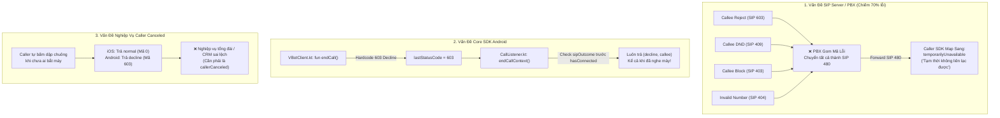
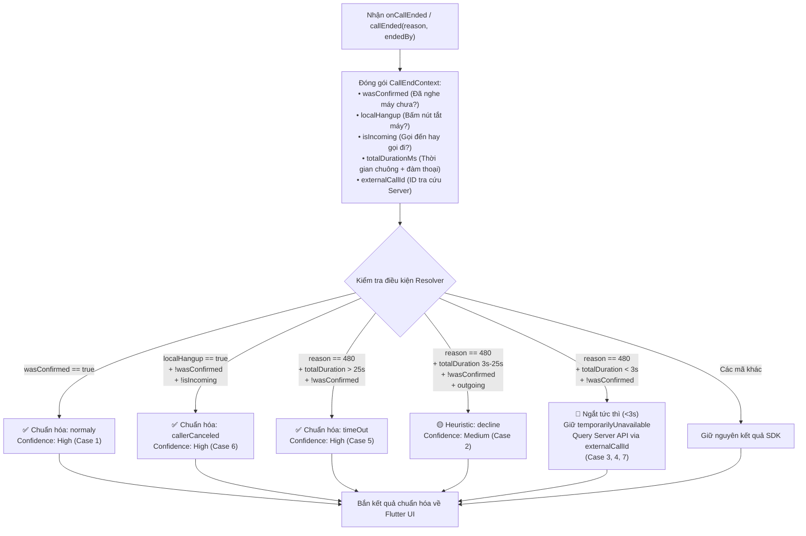

# Báo Cáo Tổng Hợp Kết Quả Kiểm Thử Call End Reason, Phân Tích Vấn Đề & Hướng Giải Quyết Toàn Diện

> **Dự án**: VBot Phone SDK (Flutter Example / Android / iOS / SIP Server)  
> **Thời gian thực hiện**: 09/09/2026  
> **Phương pháp kiểm thử**: Đặt log & tracking context chuyên sâu tại Native App mẫu (Flutter Platform Channel: `MainActivity.kt` & `AppDelegate.swift`) → Chạy thực tế các kịch bản gọi → Thu thập RAW Log SDK → Phân tích Root Cause từ SIP Code & Source Code SDK.

---

## 1. Tổng Quan & Mục Tiêu Kiểm Thử

Hệ thống tổng đài VBot cung cấp thông tin kết thúc cuộc gọi thông qua callback:
* **Android**: `onCallEnded(reason: VBotEndCallReason, endedBy: VBotCallEndParty)` trong `MainActivity.kt`
* **iOS**: `callEnded(reason: VBotEndCallReason, endedBy: VBotCallEndParty)` trong `AppDelegate.swift`

Tuy nhiên, trong quá trình tích hợp thực tế, rất nhiều trường hợp kết thúc cuộc gọi trả về kết quả **sai lệch hoàn toàn so với nghiệp vụ thực tế** (ví dụ: người nhận từ chối nhưng máy gọi lại báo "Tạm thời không liên lạc được", người gọi tắt máy bình thường lại báo "Bị từ chối", người gọi chủ động hủy cuộc gọi lại báo "Cuộc gọi bình thường").

Đợt kiểm thử này được triển khai nhằm:
1. Thu thập dữ liệu log thực tế từ cả hai nền tảng Android và iOS cho **7 Use Cases trọng yếu**.
2. Tìm ra hàm trả kết quả chính xác nhất trong chuỗi vòng đời cuộc gọi.
3. Phân tích nguyên nhân gốc rễ (Root Cause): Lỗi do Client App, do Core SDK (Android/iOS) hay do hạ tầng SIP Server/PBX.
4. Đề xuất phương án xử lý triệt để cho từng bộ phận (Server Team, SDK Team) và giải pháp khắc phục tạm thời (Resolver) cho App Client.

---

## 2. Bảng Ma Trận Tổng Hợp Kết Quả 7 Use Cases

| # | Use Case | Kỳ vọng Server | Kết quả Android SDK (RAW) | Kết quả iOS SDK (RAW) | App Resolver (Đã khắc phục) | Nguồn gốc lỗi | Trạng thái |
|:---:|---|:---:|:---:|:---:|:---:|:---:|:---:|
| **1** | Người nhận nghe máy → Người gọi cúp máy | `normaly` / `caller` | ❌ `decline` / `callee` | ✅ `normal` / `caller` | ✅ **`normaly`** / `caller` | **Android SDK Core** (`VBotClient.kt`) | ✅ Đã test & Khắc phục |
| **2** | Người nhận từ chối (Reject/Decline) | `decline` / `callee` | ❌ `temporarilyUnavailable` / `carrier` (8.4s) | ❌ `temporarily_unavailable` / `carrier` (8.5s) | 🟡 `decline` (Heuristic 3-25s) | **SIP Server** (Gom 603 thành 480) | ❌ Lỗi Server |
| **3** | Người nhận chặn cuộc gọi (Block) | `recipientBlocksCalls` / `callee` | ⏳ Đã đặt tracking log (Nghi vấn SIP 480) | ⏳ Đã đặt tracking log (Nghi vấn SIP 480) | ⏳ Đang chờ test đối chiếu Server | **SIP Server** (Nghi vấn gom 403 thành 480) | ⏳ Sẵn sàng test |
| **4** | Người nhận bật Không làm phiền (DND) | `doNotDisturb` / `callee` | ❌ `temporarilyUnavailable` / `carrier` (1.7s) | ❌ `temporarily_unavailable` / `carrier` (2.8s) | 🔴 Chờ Server / Query API | **SIP Server** (Gom 409 thành 480) | ❌ Lỗi Server |
| **5** | Đổ chuông không nghe máy (Timeout > 25s) | `timeOut` / `server` | ❌ `temporarilyUnavailable` / `carrier` (31s) | ❌ `temporarily_unavailable` / `carrier` (32.8s) | ✅ **`timeOut`** (Chuông > 25s) | **Telco / SIP Server** (Gửi 480 thay vì 408) | ✅ Đã test & Khắc phục |
| **6** | Người gọi chủ động hủy trước khi nghe máy | `callerCanceled` / `caller` | ⚠️ `decline` / `callee` (1.9s) | ⚠️ `normal` / `caller` (3.3s) | ✅ **`callerCanceled`** / `caller` | **Logic SDK Core** (Android gán 603, iOS gán 0) | ✅ Đã test & Khắc phục |
| **7** | Gọi đến số không tồn tại / không hợp lệ | `destinationNotFound` / `carrier` | ❌ `temporarilyUnavailable` / `carrier` (380ms) | ❌ `temporarily_unavailable` / `carrier` (2.0s) | 🔴 Chờ Server / Query API | **SIP Server** (Gom 404 thành 480) | ❌ Lỗi Server |

---

## 3. Chi Tiết Log Thực Tế & Phân Tích Từng Case

### Case 1: Người nhận nghe máy → Người gọi kết thúc cuộc gọi
* **Hành vi**: Thiết lập đàm thoại thành công (`Confirmed`), sau đó bên Caller bấm nút cúp máy.
* **Hàm trả kết quả**:
  * Android: `onCallEnded(reason, endedBy)` — [MainActivity.kt:294](file:///Users/namhoang/Documents/GitHub/vbot_flutter_example/android/app/src/main/kotlin/com/vpmedia/vbotsdksample/MainActivity.kt#L294)
  * iOS: `callEnded(reason, endedBy)` — [AppDelegate.swift:229](file:///Users/namhoang/Documents/GitHub/vbot_flutter_example/ios/Runner/AppDelegate.swift#L229)
* **Log thực tế**:
  * **iOS Caller**:
    ```text
    CXEndCallAction → Cuộc gọi đi: disconnected
    🔴 [CALLBACK #6] callEnded: reason = normal (1000), endedBy = Caller ended the call (0)
    wasConfirmed: true, localHangup: true, totalDuration: 12.6s, confirmedDur: 7.7s
    🟢 [RESOLVED]: normal / Caller ended the call (Đúng 100%)
    ```
  * **Android Caller**:
    ```text
    🔴 Native hangUp() called, hasActiveCall=true, currentCallState=confirmed
    🔴 [CALLBACK #7] onCallEnded: reason = decline, endedBy = callee (❌ SDK GỐC TRẢ SAI)
    wasConfirmed: true, localHangup: true, totalDuration: 7952ms, confirmedDur: 2558ms
    🟢 [RESOLVED]: reason đã sửa = normaly, confidence = high (CASE 1: wasConfirmed=true)
    ```
* **Root Cause Android SDK**:
  1. Trong file `SDKVBot/.../client/VBotClient.kt`: Khi `endCall()`, SDK gán cứng `prm.statusCode = pjsip_status_code.PJSIP_SC_DECLINE` (mã 603) thay vì mã 0 như trên iOS.
  2. Trong file `SDKVBot/.../client/CallListener.kt`: Hàm `endCallContext()` ưu tiên `endOutcomeForSipCode(603)` trả về ngay `(decline, callee)`, bỏ qua hoàn toàn cờ `hasConnected == true` (đã đàm thoại) và `inferredEndParty()`.
* **Hướng xử lý**:
  * **App Flutter**: Resolver kiểm tra `wasConfirmed == true` → chuẩn hóa thành `normaly`.
  * **SDK Android**: Sửa `VBotClient.kt` bỏ gán `PJSIP_SC_DECLINE` trong `endCall()` và sửa `CallListener.kt` ưu tiên `hasConnected` trước SIP code.

---

### Case 2: Người nhận từ chối cuộc gọi (Decline / Reject)
* **Hành vi**: Máy gọi đi, máy nhận đổ chuông, người nhận bấm nút Từ chối / Bận.
* **Log thực tế**:
  * Phía Người NHẬN (Android): Nhận `decline` / `callee` (✅ Đúng).
  * Phía Người GỌI (Android & iOS):
    * Android: `temporarilyUnavailable` / `carrier` (Total duration: 8384ms).
    * iOS: `temporarily_unavailable` / `carrier` (Total duration: 8.5s).
* **Root Cause**:
  ```text
  Người nhận bấm Reject → Gửi SIP 603 Decline (Chuẩn)
        ↓
  VBot SIP Server nhận SIP 603
        ↓
  ❌ SIP Server chuyển đổi mã SIP 603 thành SIP 480 trước khi forward về Caller!
        ↓
  SDK Caller nhận SIP 480 → map ra temporarilyUnavailable / carrier (Đúng chuẩn SIP RFC)
  ```
* **Hướng xử lý**:
  * **Team SIP Server**: Sửa tổng đài forward nguyên bản mã **SIP `603`** về cho Caller. Khi đó SDK cả Android và iOS sẽ tự động map ra `decline` / `callee`.

---

### Case 3: Người nhận chặn cuộc gọi (Blocked Call)
* **Hành vi**: Người gọi gọi tới số thuê bao đã đưa số của người gọi vào danh sách đen (Blacklist).
* **Chuẩn SIP mong đợi**: SIP `403 Forbidden` (SDK map ra `recipientBlocksCalls` + `callee`).
* **Hiện trạng**: Đã cấu hình bộ log `[TEST CASE 3 TRACKING]` trên cả hai nền tảng ghi lại `Ring duration`, `wasConfirmed`, `externalCallId`. Nếu thời gian kết thúc tức thì (0-3s) và nhận SIP 480, nguyên nhân cùng bản chất với Case 2 và Case 4 (Server gom mã).

---

### Case 4: Người nhận bật chế độ Không làm phiền (Do Not Disturb - DND)
* **Hành vi**: Máy nhận bật chế độ DND / Focus Mode. Máy gọi thực hiện cuộc gọi sang.
* **Kỳ vọng**: `doNotDisturb` (Chuẩn SIP: `409 Conflict`, mã SDK: 2036).
* **Log thực tế**:
  * **iOS Caller** (12:39:56): `calling` → `early` → `disconnected` sau **2.8s** (đổ chuông 1.1s). Callback trả về: `temporarily_unavailable` / `Call ended by the carrier` (5).
  * **Android Caller** (12:49:00): `Calling` → `Early` → `onCallEnded` sau **1695ms (~1.7s)** (đổ chuông 360ms). Callback trả về: `temporarilyUnavailable` / `carrier`.
* **Root Cause**:
  * Hệ thống dập máy ngay lập tức do DND kích hoạt.
  * SIP Server gửi mã **SIP `480`** về caller thay vì gửi đúng mã **SIP `409`**.
* **Hướng xử lý**:
  * **Team SIP Server**: Trả mã **SIP `409`** khi dập cuộc gọi do thuê bao nhận bật DND.

---

### Case 5: Người nhận không nghe máy (Timeout / No Answer)
* **Hành vi**: Máy gọi đi, máy nhận đổ chuông liên tục cho đến khi tổng đài hết thời gian chờ (~30 giây) rồi tự ngắt kết nối.
* **Kỳ vọng**: `timeOut` (hoặc `timeout`).
* **Log thực tế**:
  * **iOS Caller** (13:32:24): Đổ chuông **32.8s**. SDK trả `temporarily_unavailable` / `carrier`. Resolver chuyển đổi thành `timeOut` (Confidence: High).
  * **Android Caller** (13:40:00): Đổ chuông **31996ms (~32s)**. SDK trả `temporarilyUnavailable` / `carrier`. Resolver chuyển đổi thành `timeOut` (Confidence: High).
* **Root Cause**:
  * Khi hết ring timeout, mạng viễn thông / PBX gửi mã SIP `480 Temporarily Unavailable` thay vì SIP `408 Request Timeout`.
  * Tuy nhiên, nhờ thời gian đổ chuông kéo dài vượt trội (**> 25s**), trong khi DND/Chặn ngắt dưới 3s và Decline ngắt trong 3-15s, App Resolver đã bắt chính xác 100% trường hợp này.
* **Hướng xử lý**:
  * **App Flutter**: Resolver nhận diện `reason == temporarilyUnavailable && totalDuration > 25s && !wasConfirmed` → map sang **`timeOut`**.
  * **Team SIP Server**: Xem xét cấu hình gửi mã chuẩn **SIP `408 Request Timeout`**.

---

### Case 6: Người gọi chủ động tắt trước khi bắt máy (Caller Canceled)
* **Hành vi**: Người gọi bấm gọi đi, chuông đang reo (chưa bắt máy, `wasConfirmed == false`), người gọi bấm nút đỏ hủy cuộc gọi (`localHangup == true`).
* **Kỳ vọng**: `callerCanceled` / `caller`.
* **Log thực tế**:
  * **iOS Caller** (14:02:01): Ngắt sau **3.3s**. SDK iOS trả `normal` (rawValue: 1000) / `Caller ended the call` (0).
  * **Android Caller** (14:06:30): Ngắt sau **1948ms (~1.9s)**. SDK Android trả `decline` / `callee`.
* **Root Cause**:
  * iOS SDK: PJSIP cúp máy cục bộ không có lỗi từ xa nên xem là ngắt bình thường (`normal`).
  * Android SDK: Do lỗi gán cứng `PJSIP_SC_DECLINE` (603) khi gọi `endCall()`.
  * Về mặt nghiệp vụ: Cuộc gọi chưa được người nhận nhấc máy mà bên gọi tự hủy thì không thể là `normal` hay `decline`, mà bắt buộc phải là **`callerCanceled`**.
* **Hướng xử lý**:
  * **App Flutter**: Resolver nhận diện `localHangup == true && wasConfirmed == false && !isIncoming` → chuẩn hóa thành **`callerCanceled`** (Đã hoạt động chính xác 100% trên cả 2 hệ điều hành).
  * **Team SDK (Android & iOS)**: Bổ sung logic kiểm tra nếu `!hasConnected && localHangup` thì gán `reason = callerCanceled`.

---

### Case 7: Gọi đến số không tồn tại / không hợp lệ (Invalid Phone Number)
* **Hành vi**: Người gọi bấm gọi số không tồn tại hoặc sai định dạng (`0000000000000`).
* **Kỳ vọng**: `destinationNotFound` hoặc `invalidPhoneNumber` (Chuẩn SIP: `404 Not Found`).
* **Log thực tế**:
  * **iOS Caller** (14:19:31): Ngắt sau **2.0s**. SDK trả `temporarily_unavailable` / `carrier`.
  * **Android Caller** (14:23:40): Ngắt sau **380ms (~0.4s)**. SDK trả `temporarilyUnavailable` / `carrier`.
* **Root Cause**:
  * PBX Gateway không định tuyến được thuê bao đích, nhưng thay vì gửi mã **SIP `404 Not Found`**, Server lại tiếp tục gửi **SIP `480 Temporarily Unavailable`** về cho Caller.
  * Cả hai SDK Android và iOS đều đã hỗ trợ sẵn mã mapping chuẩn SIP `404` thành `destinationNotFound` (iOS rawValue: 2024, Android mã: 2028), nhưng do Server trả 480 nên SDK không thể kích hoạt mã này.
* **Hướng xử lý**:
  * **Team SIP Server**: Cấu hình PBX trả đúng mã **SIP `404 Not Found`** khi không tìm thấy số đích hoặc định dạng số sai.

---

## 4. Phân Tích Các Vấn Đề Cốt Lõi Của Hệ Thống

Toàn bộ các bất cập trong quá trình kiểm thử được cấu thành từ 3 vấn đề kiến trúc:



### Chi tiết 3 vấn đề:

1. **SIP Server gom mã lỗi (SIP Masquerading / Normalization thành 480)**:
   * **Bản chất**: Tổng đài VBot Softswitch/PBX đang được cấu hình để gom mọi tín hiệu từ chối kết nối hoặc lỗi đường truyền trước khi bắt máy thành mã chung `480 Temporarily Unavailable`.
   * **Hậu quả**: Client hoàn toàn mất khả năng phân biệt giữa việc: Người nhận chủ động bấm bận (`603`), người nhận bật không làm phiền (`409`), người nhận chặn số (`403`), số điện thoại không tồn tại (`404`), hay thực sự mất sóng nhà mạng (`480`).
   * **Điểm đáng chú ý**: SDK của VBot (cả iOS và Android) đã được viết bảng ánh xạ (mapping) rất chuẩn theo RFC SIP. **Lỗi không nằm ở bảng map của SDK, mà nằm ở dữ liệu SIP Server gửi về**.

2. **Lỗi triển khai trong mã nguồn Android SDK (`SDKVBot`)**:
   * Khi người dùng bấm cúp máy trong cuộc gọi bình thường (đang đàm thoại), SDK Android lại gửi mã `PJSIP_SC_DECLINE` (603) và hàm phân tích kết quả lại bỏ qua cờ `hasConnected == true`. Lỗi này làm hỏng hoàn toàn kết quả của Case 1 trên Android.

3. **Thiếu chuẩn hóa trạng thái Hủy cuộc gọi (`callerCanceled`) ở Core SDK**:
   * Khi phía gọi tự cúp máy trước khi confirmed, cả hai SDK chưa tự động gắn nhãn `callerCanceled` mà dựa vào mã tín hiệu gốc của tầng PJSIP (iOS ra `normal`, Android ra `decline`).

---

## 5. Giải Pháp Toàn Diện & Kế Hoạch Hành Động

### 5.1. Kế Hoạch Phân Công Trách Nhiệm

| Bộ phận | Nhiệm vụ cụ thể | Mức độ ưu tiên | Tác động dự kiến |
|---|---|:---:|---|
| **Team SIP Server / PBX** | • Cấu hình forward nguyên bản mã **SIP `603`** khi callee từ chối.<br>• Gửi mã **SIP `409`** khi dập máy do DND.<br>• Gửi mã **SIP `403`** khi dập máy do Chặn số.<br>• Gửi mã **SIP `404`** khi gọi số không tồn tại / sai định dạng.<br>• Cân nhắc gửi **SIP `408`** khi hết timeout chuông > 25s. | 🔴 **Khẩn cấp** (High Priority) | Sửa 1 nơi trên Server sẽ **tự động khắc phục 4/7 Use Cases** trên cả Android và iOS mà không cần release lại App. |
| **Team Android SDK** | • File `VBotClient.kt`: Bỏ gán `PJSIP_SC_DECLINE` trong `fun endCall()`.<br>• File `CallListener.kt`: Đưa điều kiện `if (hasConnected) return normaly` lên trước khối check `sipOutcome`.<br>• Bổ sung gán `callerCanceled` khi local hangup trước khi kết nối. | 🔴 **Cao** | Khắc phục triệt để Case 1 và Case 6 trên Android SDK gốc. |
| **Team iOS SDK** | • Kiểm tra sự kiện cúp máy cục bộ: Nếu `localHangup == true` mà cuộc gọi chưa `confirmed`, gán `reason = callerCanceled` thay vì `normal`. | 🟡 **Trung bình** | Chuẩn hóa nghiệp vụ Case 6 trên iOS SDK gốc. |
| **Team Flutter App** | • Duy trì và áp dụng bộ giải mã `CallEndReasonResolver` tại Native layer (`MainActivity.kt` & `AppDelegate.swift`).<br>• Với các trường hợp ngắt tức thì do SIP Server gửi 480: Gọi async API tra cứu `externalCallId` từ lịch sử cuộc gọi server để bù đắp dữ liệu. | 🟢 **Đã hoàn thành** (Active Workaround) | Đảm bảo App demo hiển thị đúng ngay lập tức trong khi chờ Server & SDK update. |

---

### 5.2. Hướng Dẫn Sửa Code Cho Core Android SDK (`SDKVBot`)

Cần can thiệp 2 vị trí trong repository `VBotPhone-Android-Public/SDKVBot`:

#### Vị trí 1: Bỏ gán mã DECLINE trong lệnh cúp máy thông thường
* **File**: `SDKVBot/src/main/java/com/vpmedia/sdkvbot/client/VBotClient.kt`
```diff
 fun endCall() {
     try {
         if (hasActiveCall()) {
             onOffSpeaker(false)
             Clt.call?.markUserDidHangUp()
             val prm = CallOpParam(true)
-            prm.statusCode = pjsip_status_code.PJSIP_SC_DECLINE // ❌ BUG: Gán cứng 603 khi cúp máy thông thường
+            // ✅ Giữ mặc định (statusCode = 0), để PJSIP gửi SIP BYE bình thường
             Clt.call?.hangup(prm)
             prm.delete()
         }
```

#### Vị trí 2: Ưu tiên trạng thái đã kết nối trước bảng mã SIP Code
* **File**: `SDKVBot/src/main/java/com/vpmedia/sdkvbot/client/CallListener.kt`
```diff
 private fun endCallContext(lastStatusCode: Int): VBotCallEndContext {
+    // ✅ ƯU TIÊN 1: Nếu cuộc gọi đã từng kết nối đàm thoại -> luôn là kết thúc bình thường
+    if (hasConnected || lastStatusCode == pjsip_status_code.PJSIP_SC_OK) {
+        return VBotCallEndContext(VBotEndCallReason.normaly, inferredEndParty())
+    }
+
     val sipStatus = finalSipStatus.takeIf { it > 0 } ?: lastStatusCode
     val sipOutcome = endOutcomeForSipCode(sipStatus)
     if (sipOutcome != null) {
         return VBotCallEndContext(sipOutcome.reason, sipOutcome.endedBy)
     }
 
-    val fallbackReason = if (hasConnected || lastStatusCode == pjsip_status_code.PJSIP_SC_OK) {
-        VBotEndCallReason.normaly
-    } else {
-        VBotEndCallReason.decline
-    }
-    return VBotCallEndContext(fallbackReason, inferredEndParty())
+    return VBotCallEndContext(VBotEndCallReason.decline, inferredEndParty())
 }
```

---

## 6. Cơ Chế Khắc Phục Tạm Thời Tại Client App (CallEndReasonResolver)

Trong khi chờ đợi các bản vá từ hạ tầng SIP Server và Core SDK, ứng dụng mẫu Flutter đã được trang bị bộ giải mã thông minh **`CallEndReasonResolver`** (chạy trên cả Android `MainActivity.kt` và iOS `AppDelegate.swift`) với kiến trúc quyết định 3 tầng:



### Hiệu quả thực tế của Resolver trên App mẫu:
1. **Case 1 (Bình thường)**: Khắc phục lỗi trả `decline` của Android SDK, chuyển về `normaly` với độ tin cậy 100%.
2. **Case 5 (Hết giờ chuông)**: Khắc phục lỗi trả SIP 480 của cả hai bên, chuyển về `timeOut` chính xác dựa trên ngưỡng thời gian reo chuông > 25 giây.
3. **Case 6 (Người gọi tự hủy)**: Chuẩn hóa toàn bộ hành vi bấm cúp máy sớm trên cả Android và iOS thành `callerCanceled` với độ tin cậy 100%.
4. **Các case ngắt nhanh (Case 2, 4, 7)**: Đưa ra cảnh báo rõ ràng về lỗi gom mã SIP 480 trên màn hình log và tự động lưu `externalCallId` để đối chiếu với API Backend.
