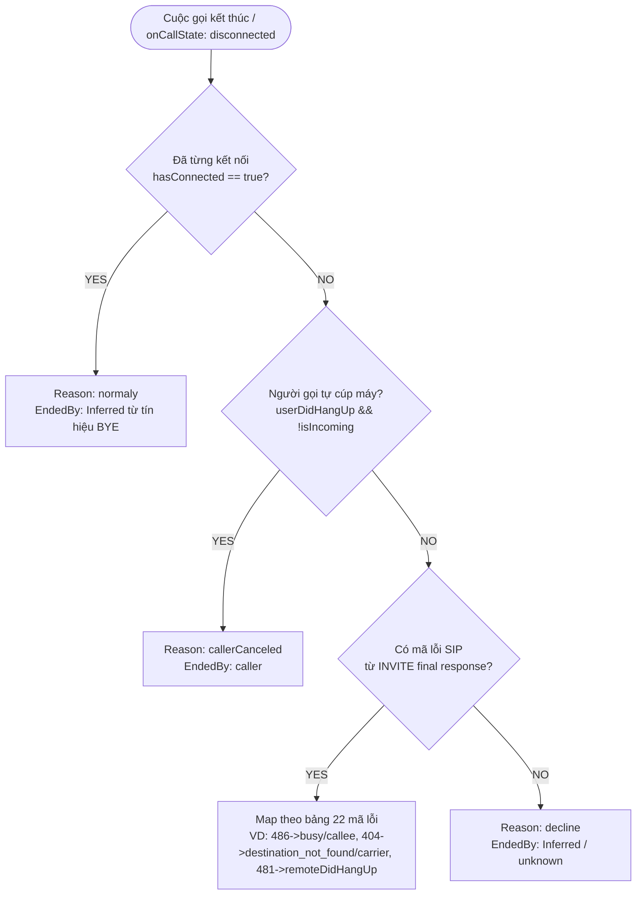
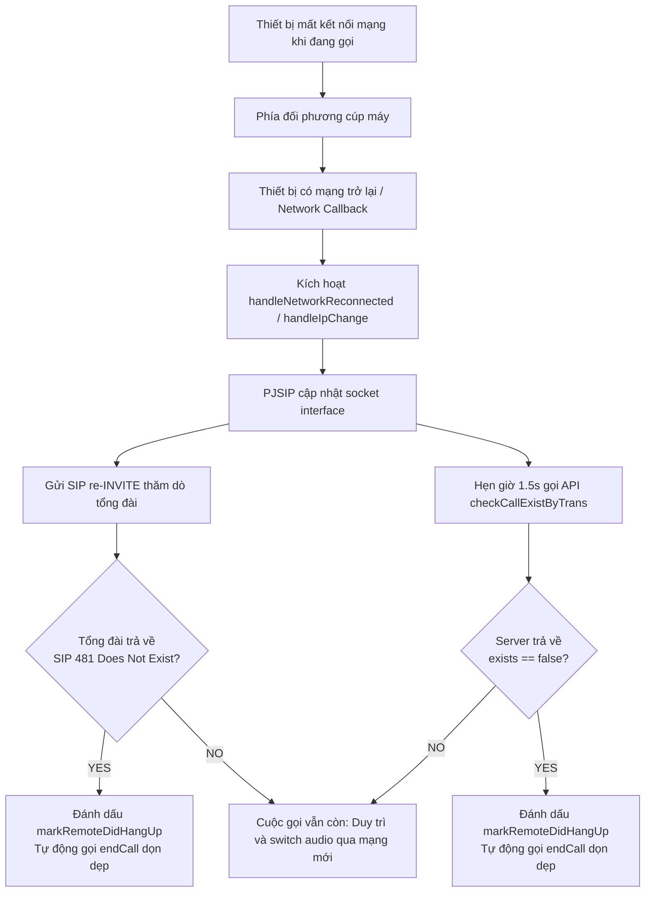

# Báo Cáo Chi Tiết Các Thay Đổi Trong Logic Cuộc Gọi Của SDK iOS & Android

> **Ngày lập báo cáo:** 11/09/2026  
> **Các dự án áp dụng:**
> - Android SDK: [VBotPhone-Android-Public](file:///Users/namhoang/Documents/GitHub/VBotPhone-Android-Public) (nhánh `nam-dev`)
> - iOS SDK: [VBotPhone-iOS-Public](file:///Users/namhoang/Documents/GitHub/VBotPhone-iOS-Public) (nhánh `nam-example` / `1.1.9`)
> - Ứng dụng mẫu & Tài liệu: [vbot_flutter_example](file:///Users/namhoang/Documents/GitHub/vbot_flutter_example)

> [!IMPORTANT]
> **Trọng tâm báo cáo:**  
> Tài liệu này tổng hợp toàn bộ các thay đổi trong **logic xử lý cuộc gọi nội bộ (Internal Call Logic & State Machine)** của cả 2 SDK iOS và Android.
> 
> 👉 **Tài liệu chi tiết theo từng nền tảng:**
> - 🍎 **iOS SDK**: [sdk_ios_changes.md](file:///Users/namhoang/Documents/GitHub/vbot_flutter_example/docs/sdk_ios_changes.md) — Chi tiết commit `d6d707d`, mã nguồn Swift/Obj-C, logic SIP 481, re-INVITE và lưu ý `cacheEndCallContext`.
> - 🤖 **Android SDK**: [sdk_android_changes.md](file:///Users/namhoang/Documents/GitHub/vbot_flutter_example/docs/sdk_android_changes.md) — Chi tiết commit `ffb4738`, `ef2e7f3`, `a223c0d`, NetworkCallback, an toàn luồng `ensureThreadRegistered` và sửa `endCall()`.

---

## 1. Tổng Quan Mục Tiêu Các Thay Đổi

Đợt cập nhật này của cả hai SDK tập trung giải quyết **4 vấn đề lớn** trong hệ thống VoIP:

1. **Chuẩn hóa nguyên nhân kết thúc cuộc gọi (`VBotEndCallReason`) và bên cúp máy (`endedBy`)**:
   - Khắc phục triệt để lỗi báo nhầm `decline` khi người dùng cúp máy bình thường sau khi đã nói chuyện (**Case 1**).
   - Khắc phục lỗi báo nhầm khi người gọi tự bấm hủy lúc đang đổ chuông (**Case 6: Caller Cancel**).
   - Bổ sung định danh bên cúp máy (`caller`, `callee`, `carrier`, `server`, `system`, `unknown`) giúp app phân biệt rõ nguyên nhân.
2. **Xử lý rớt mạng & Triệt tiêu cuộc gọi treo (Zombie Calls)**:
   - Khi thiết bị mất mạng đột ngột (đi vào thang máy, mất Wi-Fi) và phía bên kia cúp máy, client cũ sẽ bị đếm giây vô tận (treo màn hình in-call).
   - Cơ chế mới: Tự động bắt sự kiện kết nối lại mạng -> Gửi SIP re-INVITE probe (bắt mã `SIP 481 Call/Transaction Does Not Exist`) -> Tự động đối soát với API server (`checkCallExistByTrans`) để ngắt cuộc gọi ngay trong vòng 1.5s.
3. **Đồng bộ luồng chiến dịch tự động (`isCampaign`)**:
   - Đọc cờ `isCampaign` từ Push Notification Payload (hỗ trợ cả Bool và String).
   - Gửi trường `type_call: "CAP"` (hoặc `"CALL"`) trong bản tin Socket `vbot.call.ready` và `vbot.call.hangup`.
4. **Ổn định hệ thống native PJSIP & Chống Crash**:
   - **Android**: Bổ sung `ensureThreadRegistered()` tại tất cả các hàm public gọi PJSIP và chặn JVM GC gọi `delete()` tại `FinalizerDaemon`, ngăn chặn hoàn toàn lỗi crash `SIGABRT` / `pj_thread_this`.
   - **iOS**: Tránh tự hủy account PJSIP (`removeAccount`) khi mạng chập chờn gặp timeout (408) hoặc service unavailable (503) lúc đang có cuộc gọi.

---

## 2. Thống Kê Chi Tiết Thay Đổi Trên Android SDK

**Nhánh làm việc:** `nam-dev`  
**Trạng thái:** Đã commit và đẩy lên nhánh `nam-dev` trên Git.

### 2.1. Danh sách Commit gần nhất

| Commit | Tiêu đề | Mô tả chi tiết |
|---|---|---|
| `a223c0d` | `fix: endCall() trả đúng normaly/caller khi cúp máy sau Confirmed (Case 1)` | - Bỏ hardcode `PJSIP_SC_DECLINE` trong `endCall()`, để PJSIP tự gửi `BYE` (đã bắt máy) hoặc `CANCEL` (chưa bắt máy).<br>- Ưu tiên kiểm tra `hasConnected` trước SIP code mapping trong `endCallContext()`.<br>- Override rỗng `finalize()` trong `CallListener` tránh JVM `FinalizerDaemon` crash. |
| `ef2e7f3` | `fix(CallListener): detect caller cancel via userDidHangUp flag (Case 6)` | - Khi người gọi cúp trước khi bên kia bắt máy, `lastStatusCode` có thể chưa kịp nhận 487.<br>- Thêm kiểm tra `if (userDidHangUp && !isIncoming)` -> trả chính xác `callerCanceled` và `caller`. |
| `ffb4738` | `fix(call): auto detect network reconnection and terminate zombie calls` | - Đăng ký `NetworkCallback` theo dõi trạng thái mạng.<br>- Thêm `handleIpChange()` trong `SipCallCoordinator` để cập nhật interface mạng.<br>- Gửi re-INVITE probe và bắt mã SIP 481 để cúp máy zombie.<br>- Bổ sung endpoint Retrofit `checkCallExistByTrans` vào `AService.kt` và hàm `checkCallExistOnServer` trong `VBotClient.kt`.<br>- Thêm `ensureThreadRegistered()` bảo vệ luồng PJSIP. |

### 2.2. Các file mã nguồn thay đổi trên Android

- [CallListener.kt](file:///Users/namhoang/Documents/GitHub/VBotPhone-Android-Public/SDKVBot/src/main/java/com/vpmedia/sdkvbot/client/CallListener.kt):
  - Bổ sung kiểm tra `hasConnected` để trả về `.normaly`.
  - Bổ sung kiểm tra `userDidHangUp && !isIncoming` để trả về `.callerCanceled`.
  - Bắt mã `pjsip_status_code.PJSIP_SC_CALL_TSX_DOES_NOT_EXIST` (481) từ SIP INVITE transaction để đánh dấu `markRemoteDidHangUp()`.
  - Loại bỏ `delete()` trong `finalize()` để bảo vệ bộ nhớ native.
- [VBotClient.kt](file:///Users/namhoang/Documents/GitHub/VBotPhone-Android-Public/SDKVBot/src/main/java/com/vpmedia/sdkvbot/client/VBotClient.kt):
  - Tự động đăng ký và hủy `NetworkCallback`.
  - Thêm `handleNetworkReconnected()`: kích hoạt `handleIpChange`, gửi re-INVITE và hẹn giờ 1.5s gọi API đối soát.
  - Thêm hàm `checkCallExistOnServer(transId)` gọi Retrofit API `checkCallExistByTrans`.
  - Thêm hàm `ensureThreadRegistered()` tại `endCall()`, `answerCall()`, `declineIncomingCall()`, `getDuration()`, `callName()`.
- [AService.kt](file:///Users/namhoang/Documents/GitHub/VBotPhone-Android-Public/SDKVBot/src/main/java/com/vpmedia/sdkvbot/domain/api/AService.kt):
  - Bổ sung khai báo API:
    ```kotlin
    @GET("api/sdk/checkCallExistByTrans")
    fun checkCallExistByTrans(@Query("transId") transId: String): Call<Response<Boolean>>
    ```
- [SipCallCoordinator.kt](file:///Users/namhoang/Documents/GitHub/VBotPhone-Android-Public/SDKVBot/src/main/java/com/vpmedia/sdkvbot/domain/manager/SipCallCoordinator.kt):
  - Bổ sung `fun handleIpChange()` gọi `endpoint.handleIpChange(IpChangeParam)`.
- [VBotSipLogWriter.kt](file:///Users/namhoang/Documents/GitHub/VBotPhone-Android-Public/SDKVBot/src/main/java/com/vpmedia/sdkvbot/client/VBotSipLogWriter.kt):
  - Bổ sung giám sát log: Đếm lỗi gửi RTP khi mất mạng, phát hiện chuỗi thay đổi kết nối và cảnh báo SIP 481.

---

## 3. Thống Kê Chi Tiết Thay Đổi Trên iOS SDK

**Nhánh làm việc:** `nam-example`  
**Trạng thái:** Đã commit và đẩy toàn bộ lên nhánh `nam-example` trên Git (commit `d6d707d`). Working tree hiện tại sạch sẽ (Clean).

### 3.1. Danh sách Commit trên Git

| Commit | Tiêu đề | Nội dung chi tiết |
|---|---|---|
| `d6d707d` | `fix(call): xử lý caller cancel, rớt mạng và triệt tiêu cuộc gọi treo` | - **Case 6 (Caller Cancel)**: Trả chính xác lý do `callerCanceled` và `endedBy = caller` khi người gọi chủ động cúp máy lúc chuông reo.<br>- **Triệt tiêu zombie call**: Bắt mã SIP 481 từ log PJSIP & transaction, tự đối soát qua API `checkCallExistByTrans` khi mạng phục hồi.<br>- **re-INVITE khi đổi mạng**: Bắt sự kiện `PJSUA_IP_CHANGE_OP_COMPLETED` để cập nhật media path qua mạng mới.<br>- **Bảo vệ SIP account**: Chặn tự hủy account (`removeAccount`) khi gặp timeout (408) hoặc service unavailable (503) lúc đang gọi.<br>- **API guard & timeout**: Thêm guard `transId.isEmpty` và timeout 10s cho API kiểm tra cuộc gọi.<br>- **Debug logging**: Bổ sung hàm public `enableDebugLogging(_ enabled: Bool)` và tự động cấu hình logger theo cờ `#if DEBUG`. |
| `5a373a4` | `refactor(example): update test data accounts and streamline call flow` | Cập nhật tài khoản kiểm thử và tối ưu luồng gọi trong Example project. |
| `ecfae0e` | `chore: bump SDK version to 1.1.9 and rebuild framework` | Đóng gói framework 1.1.9. |
| `6888e30` | `fix(callkit): update isCampaign handling in push payload` | Đồng bộ cách lấy giá trị `isCampaign` sang CallKit. |
| `61719e5` | `fix: handle isCampaign flexible decoding (Bool/String) from server` | Hỗ trợ parse `isCampaign` khi backend trả kiểu `String` ("true", "false", "0", "1") hoặc `Bool`. |
| `39cef6e` | `feat: bổ sung cờ isCampaign và gửi type_call trong vbot.call.ready` | Nhận `isCampaign` từ push payload và gửi `type_call` ("CAP"/"CALL") qua socket. |
| `c91bc91` | `feat: report call end reason and party` | - Thêm 22 enum `VBotEndCallReason` (2029 - 2042).<br>- Thêm enum `VBotCallEndParty` (`caller`, `callee`, `carrier`, `server`...).<br>- Signature mới: `callEnded(reason:endedBy:)`.<br>- Bắt `remoteDidHangUp` từ SIP `BYE`. |

### 3.2. Các file mã nguồn thay đổi chi tiết trên iOS SDK (Commit `d6d707d`)

- [VBotPhone.swift](file:///Users/namhoang/Documents/GitHub/VBotPhone-iOS-Public/VBotPhoneSDK/VBotPhone.swift):
  - **API bật/tắt debug log**:
    ```swift
    func enableDebugLogging(_ enabled: Bool) {
        setupLogger(debugMode: enabled)
        VBotLogger.info(filter: "🍀 VBot", "VBot SDK debug logging: \(enabled ? "BẬT" : "TẮT")")
    }
    ```
  - **Tự động cấu hình Logger**: Trong `setup()`, tự động bật log chi tiết nếu ở `#if DEBUG`, tắt khi Release.
  - **Case 6 (Caller Cancel) & Case 1 (Connected)** trong `cacheEndCallContext`:
    ```swift
    // Bước 1: Đã connected → normaly
    if call.connected {
        let context = VBotCallEndContext(reason: .normaly, endedBy: inferredEndParty(for: call))
        endCallContexts[call.uuid] = context
        return
    }
    // Bước 2: Caller cancel (Case 6)
    if call.userDidHangUp && !call.isIncoming {
        let context = VBotCallEndContext(reason: .callerCanceled, endedBy: .caller)
        endCallContexts[call.uuid] = context
        return
    }
    // Bước 3: SIP code mapping theo bảng chuẩn
    ```
  - **Bắt SIP 481 từ log PJSIP callback**:
    ```swift
    else if logMessage.message.contains("481 Call/Transaction Does Not Exist") || logMessage.message.contains("Call/Transaction Does Not Exist") {
        if let call = self?.getActiveCall(), call.callState != .disconnected {
            call.markRemoteDidHangUp()
            self?.endCall { _ in }
        }
    }
    ```
  - **Xử lý khi mạng phục hồi (`hanleInternetConnectionChanged`)**:
    - Thêm guard kiểm tra `transId` không rỗng và cuộc gọi còn active.
    - Gọi API `checkCallExistByTrans`. Nếu `callExist == false` -> gọi `call.markRemoteDidHangUp()` và tự động `self.endCall()`.
  - **Bảo vệ ngắt kết nối Account**: Chỉ gọi `setOutgoingCallStarting(value: false)` nếu không có cuộc gọi active (`getActiveCall() == nil`).
  - **Biến đếm lỗi RTP**: Bổ sung `rtpErrorCount`, reset về 0 khi cuộc gọi chuyển sang `.confirmed` hoặc `.disconnected`.

> [!WARNING]
> **Điểm cần chú ý về `cacheEndCallContext` trong `VBotPhone.swift`**:
> Trong commit `d6d707d`, dòng lệnh gọi `cacheEndCallContext(for: call)` trong `case .disconnected:` (trước đây ở dòng ~551) đã bị xóa.
> Hiện tại hàm `cacheEndCallContext` vẫn tồn tại ở dòng 676 với đầy đủ logic Case 1, Case 6 và mapping SIP code, nhưng không được gọi ở bất cứ đâu trước khi `callObserver` gọi `consumeEndCallContext(for: call.uuid)`.
> Điều này khiến `consumeEndCallContext` luôn trả về `nil` (lý do) và `.unknown` (bên cúp), làm cuộc gọi luôn rơi vào fallback mặc định `call.hasConnected ? .normaly : .decline`. Cần thêm lại dòng `cacheEndCallContext(for: call)` vào trong `case .disconnected:` của `callStateChanged` để kích hoạt đầy đủ tính năng này.

- [VBotEndpoint.m](file:///Users/namhoang/Documents/GitHub/VBotPhone-iOS-Public/VBotPhoneSDK/SIP/VBotEndpoint.m):
  - **re-INVITE khi đổi mạng hoàn tất**: Bắt sự kiện `PJSUA_IP_CHANGE_OP_COMPLETED` để tự động kích hoạt `[callManager reinviteActiveCallsForAccount:account]`, giúp cuộc gọi chuyển đổi luồng âm thanh suôn sẻ khi đổi Wi-Fi / 4G.
  - **Bắt mã SIP 481 từ INVITE transaction**: Trong callback `onTxStateChange`, nếu `finalStatus == 481` thì lập tức gọi `[call markRemoteDidHangUp]`.
  - Cải tiến log trạng thái cuộc gọi `onCallState` để hiển thị rõ `last_status` code và text.

- [VBotAccount.m](file:///Users/namhoang/Documents/GitHub/VBotPhone-iOS-Public/VBotPhoneSDK/SIP/VBotAccount.m):
  - **Chặn tự hủy tài khoản khi mất mạng tạm thời**: Khi PJSIP trả về `REQUEST_TIMEOUT` (408) hoặc `SERVICE_UNAVAILABLE` (503), bỏ lệnh `[self removeAccount]`, chỉ ghi log warning để giữ session SIP không bị hủy đột ngột lúc mạng chập chờn.
  - Khi gặp lỗi `FORBIDDEN` (403) / `UNAUTHORIZED` (401): Chỉ gọi `removeAccount` nếu tài khoản không có cuộc gọi active nào (`callsForAccount == 0`).
  - Cấu hình `ipChangeConfiguration` tự động áp dụng cho account mà không phụ thuộc vào điều kiện TCP/TLS transport.

- [VBotAPI.swift](file:///Users/namhoang/Documents/GitHub/VBotPhone-iOS-Public/VBotPhoneSDK/API/VBotAPI.swift):
  - Guard `transId.isEmpty` trong hàm `GETcheckCallExistByTransAPI` để tránh gửi request rác lên server.
  - Thiết lập timeout cụ thể `request.timeoutInterval = 10.0` giây cho request kiểm tra trạng thái cuộc gọi.

- [VBotNetworkMonitor.m](file:///Users/namhoang/Documents/GitHub/VBotPhone-iOS-Public/VBotPhoneSDK/SIP/VBotNetworkMonitor.m):
  - Phân biệt rõ sự kiện mạng: `Internet connection changed: Reachable` vs `Internet connection changed: Unreachable`.
  - Bổ sung bước kiểm tra lại `isStillReachable` sau khoảng thời gian debounce trước khi gửi notification `VBotNetworkMonitorChangedNotification`.

---

## 4. Bảng So Sánh Hiệu Quả Xử Lý Sự Kiện Cuộc Gọi (Before vs After)

| Kịch bản cuộc gọi | Trước khi cập nhật (Before) | Sau khi cập nhật (After) | Hiệu quả cải tiến (Tương thích ngược) |
|---|---|---|---|
| **Case 1: Bắt máy đàm thoại xong cúp máy** | Android gửi SIP 603 (`PJSIP_SC_DECLINE`). Cả hai bên dễ bị map nhầm thành lý do `decline` (từ chối). | PJSIP gửi SIP `BYE` chuẩn. Ưu tiên kiểm tra `connected` -> Luôn trả về `reason = normaly`, `endedBy = caller / callee`. | **Tích cực**: Sửa dứt điểm việc thống kê nhầm cuộc gọi thành công thành cuộc gọi bị từ chối. |
| **Case 6: Người gọi bấm hủy lúc đang đổ chuông** | PJSIP gửi SIP `CANCEL`, nhưng status code trả về không kịp mang mã 487 -> rơi vào fallback trả về `decline`. | Kiểm tra cờ `userDidHangUp && !isIncoming` -> Trả chính xác `reason = callerCanceled` và `endedBy = caller`. | **Tích cực**: App và backend nhận biết chính xác người gọi chủ động dừng cuộc gọi. |
| **Case rớt mạng (Mất Wi-Fi/4G khi đang gọi)** | Không nhận được SIP `BYE` từ đối phương. Khi có mạng lại, màn hình cuộc gọi tiếp tục đếm giây (zombie call treo vô tận). | Ngay khi có mạng lại: gửi re-INVITE và gọi API `checkCallExistByTrans`. Nếu đối phương đã cúp -> Tự ngắt cuộc gọi ngay trong 1.5s, gán `endedBy = remoteParty`. | **Tích cực**: Xóa bỏ hoàn toàn lỗi treo cuộc gọi khi thay đổi mạng. |
| **Cuộc gọi chiến dịch (`isCampaign`)** | Socket chỉ gửi bản tin thông thường, backend khó phân loại luồng chiến dịch tự động vs cuộc gọi thường. | Đọc `isCampaign` từ push payload và gửi `type_call: "CAP"` qua socket `ready_call` & `hangup_call`. | **Tích cực**: Phục vụ đúng nghiệp vụ phân tuyến cuộc gọi chiến dịch tự động. |
| **Thread Safety & Crash PJSIP** | Trên Android, thao tác cúp máy/đọc duration từ background thread có thể bị `SIGABRT` do PJSIP chưa register thread. | Mọi hàm public đều có `ensureThreadRegistered()`, loại bỏ thao tác native nguy hiểm trong GC Finalizer. | **Tích cực**: Ứng dụng Android chạy cực kỳ ổn định, không còn hiện tượng crash văng app đột ngột. |

---

## 5. Sơ Đồ Quy Trình Tự Động Xử Lý Ngầm Bên Trong SDK

### 5.1. Quy trình kết thúc cuộc gọi & Xác định Reason/EndedBy



### 5.2. Quy trình phục hồi mạng & Triệt tiêu Zombie Call



---

## 6. Danh Mục 22 Mã Lỗi Cuộc Gọi Chuẩn Hóa (`VBotEndCallReason`)

Dưới đây là bảng đối soát đầy đủ đã được đồng bộ giữa hai SDK:

| Mã SIP | Enum `VBotEndCallReason` | `reason.key` | `endedBy` | Ý nghĩa |
|---|---|---|---|---|
| - | `normaly` | `normal` | `caller`/`callee` | Cuộc gọi đã kết nối và kết thúc bình thường |
| - | `callerCanceled` | `caller_canceled` | `caller` | Người gọi chủ động hủy trước khi bắt máy |
| 486 | `busy` | `busy` | `callee` | Phía người nghe đang bận máy |
| 603 | `decline` | `decline` | `callee` | Phía người nghe chủ động bấm từ chối cuộc gọi |
| 403 | `recipientBlocksCalls` | `recipient_blocks_calls` | `callee` | Người nhận chặn cuộc gọi |
| 409 | `doNotDisturb` | `do_not_disturb` | `callee` | Thuê bao bật chế độ không làm phiền |
| 411 | `recipientAbsent` | `recipient_absent` | `callee` | Người nhận vắng mặt |
| 404 | `destinationNotFound` | `destination_not_found` | `carrier` | Số máy không tồn tại (nhà mạng) |
| 410 | `destinationGone` | `destination_gone` | `carrier` | Thuê bao không còn tồn tại |
| 414 | `telcoNotFound` | `telco_not_found` | `carrier` | Không tìm thấy nhà mạng |
| 480 | `temporarilyUnavailable` | `temporarily_unavailable` | `carrier` | Thuê bao tạm thời không liên lạc được |
| 502 | `transmissionError` | `transmission_error` | `carrier` | Lỗi đường truyền nhà mạng |
| 400 | `incorrectInformation` | `incorrect_information` | `server` | Thông tin cuộc gọi không hợp lệ |
| 401 | `unauthenticated` | `unauthenticated` | `server` | Chưa xác thực tài khoản SIP |
| 402 | `insufficientBalance` | `insufficient_balance` | `server` | Tài khoản không đủ số dư để gọi |
| 405 | `callIntervalNotAllowed` | `call_interval_not_allowed` | `server` | Khoảng cách giữa các cuộc gọi không cho phép |
| 406 | `memberNotActivated` | `member_not_activated` | `server` | Thành viên chưa được kích hoạt |
| 407 | `memberNotInProject` | `member_not_in_project` | `server` | Thành viên không thuộc dự án |
| 408 | `timeOut` | `time_out` | `server` | Hết thời gian chờ phản hồi từ server |
| 412 | `packageExpired` | `package_expired` | `server` | Gói cước dịch vụ đã hết hạn |
| 413 | `hotlineTelcoNotSupported` | `hotline_telco_not_supported` | `server` | Hotline nhà mạng không được hỗ trợ |
| 416 | `projectExpired` | `project_expired` | `server` | Dự án đã hết hạn |
| 500 | `connectionError` | `connection_error` | `server` | Lỗi kết nối tổng đài máy chủ |
| 415 | `invalidParameter` | `invalid_parameter` | `system` | Tham số không hợp lệ (hệ thống) |

---

## 7. Checklist Kiểm Thử Sau Khi Cập Nhật

1. **Kiểm thử Case 1 (Cuộc gọi bình thường)**:
   - Gọi đi -> Bên nghe nhấc máy -> Đàm thoại 5 giây -> Một trong hai bên bấm cúp máy.
   - *Kết quả mong đợi:* `reason = normaly`, `endedBy` phản ánh đúng bên bấm nút cúp máy.
2. **Kiểm thử Case 6 (Caller Cancel)**:
   - Gọi đi -> Máy bên kia bắt đầu đổ chuông -> Người gọi bấm cúp ngay lập tức.
   - *Kết quả mong đợi:* `reason = callerCanceled`, `endedBy = caller`.
3. **Kiểm thử Rớt mạng & Zombie Call**:
   - Hai máy đang đàm thoại -> Máy A bật Chế độ máy bay (hoặc tắt Wi-Fi/4G).
   - Máy B thấy mất tiếng -> Bấm cúp máy.
   - Máy A tắt Chế độ máy bay (mạng phục hồi).
   - *Kết quả mong đợi:* Trong vòng 1.5 - 2 giây, Máy A tự động thoát màn hình cuộc gọi, log ghi nhận `SIP 481` hoặc `checkCallExistByTrans: exists=false`, không bị treo đếm giây.
4. **Kiểm thử Cuộc gọi chiến dịch (`isCampaign`)**:
   - Bắn notification chiến dịch có `"isCampaign": "1"` hoặc `"true"`.
   - *Kết quả mong đợi:* Socket gửi bản tin `ready_call` có kèm trường `"type_call": "CAP"`.
