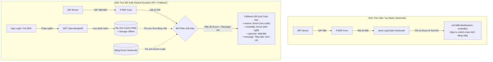

# Hướng Dẫn Tích Hợp API Danh Sách SIP Code Vào SDK (Dynamic SIP Code Architecture)

> **Tài liệu đặc tả kiến trúc & giải pháp kỹ thuật**: Hướng dẫn triển khai cơ chế gọi API tải danh sách SIP Code, lưu cache và đối chiếu động khi kết thúc cuộc gọi trên VBot Phone SDK (Android, iOS và Flutter).  
> **Tham chiếu đối chuẩn**: Mô hình hiện hành trên [VBot Console Web](file:///Users/namhoang/Documents/GitHub/vbot-console/src/renderer/store/modules/sipCode.ts) và hệ thống enum trong [VBotEndCallReason.kt](file:///Users/namhoang/Documents/GitHub/VBotPhone-Android-Public/SDKVBot/src/main/java/com/vpmedia/sdkvbot/en/VBotEndCallReason.kt).

---

## Mục Lục
1. [Bối Cảnh & Mục Tiêu](#1-bối-cảnh--mục-tiêu)
2. [So Sánh Kiến Trúc Hiện Tại vs Kiến Trúc Đề Xuất](#2-so-sánh-kiến-trúc-hiện-tại-vs-kiến-trúc-đề-xuất)
3. [Mô Hình Dữ Liệu & API Tham Chiếu](#3-mô-hình-dữ-liệu--api-tham-chiếu)
4. [Luồng Xử Lý Chi Tiết (Detailed Workflow)](#4-luồng-xử-lý-chi-tiết-detailed-workflow)
5. [Quy Tắc Đối Chiếu & Xử Lý Mã Lạ (Resolution Priority)](#5-quy-tắc-đối-chiếu--xử-lý-mã-lạ-resolution-priority)
6. [Thiết Kế Tương Thích Ngược (Backward Compatibility)](#6-thiết-kế-tương-thích-ngược-backward-compatibility)
7. [Đặc Tả Kỹ Thuật Theo Từng Nền Tảng (Android / iOS / Flutter)](#7-đặc-tả-kỹ-thuật-theo-từng-nền-tảng-android--ios--flutter)
8. [Kế Hoạch Triển Khai & Test Cases](#8-kế-hoạch-triển-khai--test-cases)

---

## 1. Bối Cảnh & Mục Tiêu

### 1.1. Hiện trạng SDK
Hiện tại, VBot Mobile SDK (Android/iOS) đang quản lý lý do kết thúc cuộc gọi theo phương thức **Hardcode tĩnh**:
* Mã SIP được map cố định vào enum `VBotEndCallReason` (ví dụ: `486 -> busy`, `403 -> recipientBlocksCalls`).
* Mô tả hiển thị chỉ có tiếng Anh (`reason.description`), các ứng dụng tích hợp (như Flutter) phải tự viết switch-case để dịch câu thông báo tiếng Việt cho người dùng.
* **Hạn chế lớn:** Khi tổng đài/nhà mạng bổ sung mã SIP mới (hoặc thay đổi câu chữ hiển thị), SDK không nhận diện được và rơi vào fallback sai (như bị gán thành `decline` hoặc `unknownError`). Để cập nhật, bắt buộc phải sửa code SDK, build lại framework/AAR và yêu cầu tất cả khách hàng cập nhật app.

### 1.2. Mục tiêu đề xuất
Học tập cơ chế đã chạy ổn định trên **Web Console**:
* SDK sẽ tải trước danh sách SIP Code từ API (`GET /sipcode/getAll?type=CDR`) ngay khi đăng nhập và lưu cache.
* Khi cuộc gọi kết thúc:
  * **Về phía User (UI):** Lấy trực tiếp câu thông báo tiếng Việt/tiếng Anh chuẩn xác từ Server hiển thị lên màn hình.
  * **Về phía Developer (Code):** Vẫn cung cấp đầy đủ enum `VBotEndCallReason` và `VBotCallEndParty` để xử lý logic lập trình.
* **Đảm bảo tính tương thích ngược 100%:** Các app đang dùng SDK cũ không cần sửa đổi bất kỳ dòng code nào.

---

## 2. So Sánh Kiến Trúc Hiện Tại vs Kiến Trúc Đề Xuất



---

## 3. Mô Hình Dữ Liệu & API Tham Chiếu

### 3.1. Endpoint Backend
* **Method:** `GET`
* **URL:** `/sipcode/getAll?type=CDR` (hoặc endpoint tương đương trong SDK Gateway)
* **Auth:** Bearer Token của tài khoản đang đăng nhập SDK.

### 3.2. Cấu trúc dữ liệu trả về từ API (`SipCodeItem`)
```json
[
  {
    "sip_code": "200",
    "disposition": "ANSWER",
    "hangup_cause": "NORMAL_CLEARING",
    "q850": 16,
    "vi": "200: Nghe máy",
    "en": "200: Answered"
  },
  {
    "sip_code": "486",
    "disposition": "BUSY",
    "hangup_cause": "USER_BUSY",
    "q850": 17,
    "vi": "486: Máy bận",
    "en": "486: Busy"
  },
  {
    "sip_code": "403",
    "disposition": "RECIPIENT_BLOCKS_CALLS",
    "hangup_cause": "CALL_REJECTED",
    "q850": 21,
    "vi": "403: Người nhận chặn cuộc gọi",
    "en": "403: Forbidden"
  }
]
```

### 3.3. Model kết quả cuộc gọi mới trong SDK (`VBotCallEndResult`)
```kotlin
data class VBotCallEndResult(
    /** Enum dùng cho logic code (if/switch-case) */
    val reason: VBotEndCallReason,
    
    /** Bên kết thúc cuộc gọi: caller, callee, server, carrier, system */
    val endedBy: VBotCallEndParty,
    
    /** Mã số SIP thực tế từ bản tin SIP (ví dụ: 200, 486, 488...) */
    val sipCode: Int?,
    
    /** Mã phân loại cuộc gọi từ CDR (ví dụ: ANSWER, BUSY, NOANSWER...) */
    val disposition: String?,
    
    /** Chuỗi thông báo tiếng Việt chuẩn từ Server để hiển thị lên UI */
    val messageVi: String?,
    
    /** Chuỗi thông báo tiếng Anh */
    val messageEn: String?
) {
    /** Helper lấy thông báo theo ngôn ngữ */
    fun getDisplayMessage(language: String = "vi"): String {
        val msg = if (language.lowercase() == "vi") messageVi else messageEn
        return msg ?: reason.description
    }
}
```

---

## 4. Luồng Xử Lý Chi Tiết (Detailed Workflow)

### Bước 1: Tải & Lưu Cache (Initialization)
1. Khi app gọi `client.login()` hoặc `client.setup()` thành công:
2. SDK kích hoạt một tác vụ chạy ngầm (**background, non-blocking**, không làm chậm tiến trình login/ready cuộc gọi).
3. Gọi API lấy danh sách SIP Code:
   * Nếu thành công:
     * Lưu vào biến RAM: `cachedSipCodeList: List<SipCodeItem>`.
     * Ghi đè vào bộ nhớ máy (`SharedPreferences` / `UserDefaults`) để lần sau mở app không có mạng vẫn có dữ liệu dùng ngay.
   * Nếu thất bại (mất mạng, timeout): Ghi log cảnh báo, SDK sẽ đọc từ bộ nhớ máy trước đó hoặc dùng bảng Hardcode.

### Bước 2: Bắt sự kiện khi cuộc gọi kết thúc
Tại tầng Core SIP Listener (`CallListener.kt` trên Android / `VBotCall` trên iOS):
1. Khi cuộc gọi ngắt (`onCallState(DISCONNECTED)` hoặc `onCallTsxState`):
2. Lấy ra các tham số tín hiệu:
   * `sipCode`: Status code số nguyên từ bản tin SIP (ví dụ `486`, `403`, `200`...).
   * `lastReason`: Chuỗi cause từ SIP header (ví dụ: `"User Busy"`, `"Terminated"`).
   * `userDidHangUp` / `remoteDidHangUp`: Xác định người gác máy.

### Bước 3: Phân giải kết quả (Resolution)
1. **Tìm kiếm thông tin hiển thị (từ Cache API):**
   * Tra cứu theo `sip_code == sipCode`.
   * Nếu thấy $\rightarrow$ Lấy `vi`, `en`, `disposition`.
   * Nếu không thấy $\rightarrow$ Tra cứu theo `hangup_cause == lastReason`.
   * Nếu vẫn không thấy $\rightarrow$ Dùng text fallback: `"Kết thúc cuộc gọi: $sipCode"`.
2. **Tìm kiếm Enum logic (từ Hardcode):**
   * Tra cứu `endOutcomeForSipCode(sipCode)` để lấy cặp `(reason, endedBy)`.
   * Nếu là mã mới chưa có trong code $\rightarrow$ Gán `reason = VBotEndCallReason.unknownError` (hoặc `.other`) và `endedBy = VBotCallEndParty.server`.

### Bước 4: Phát tán callback
SDK gọi đồng thời cả callback mới và chuyển tiếp về callback cũ (xem Mục 6).

---

## 5. Quy Tắc Đối Chiếu & Xử Lý Mã Lạ (Resolution Priority)

| Tình Huống | Tra Cứu API Cache | Tra Cứu Hardcode | Kết Quả Trả Về Cho App |
| :--- | :--- | :--- | :--- |
| **1. Mã đã biết (Ví dụ: 486)** | Khớp item `486`<br>$\rightarrow$ `vi = "486: Máy bận"` | Khớp `486`<br>$\rightarrow$ `reason = busy`, `endedBy = callee` | • `reason`: `busy`<br>• `endedBy`: `callee`<br>• `sipCode`: `486`<br>• `message`: `"486: Máy bận"` |
| **2. Mã mới tinh (Ví dụ: 488 - Server vừa thêm)** | Khớp item `488`<br>$\rightarrow$ `vi = "488: Không hỗ trợ âm thanh"` | Không khớp (`null`) | • `reason`: `unknownError`<br>• `endedBy`: `server`<br>• `sipCode`: `488`<br>• `message`: `"488: Không hỗ trợ âm thanh"` |
| **3. Mất mạng / API lỗi (Offline)** | Không có cache API | Khớp `486`<br>$\rightarrow$ `reason = busy`, `endedBy = callee` | • `reason`: `busy`<br>• `endedBy`: `callee`<br>• `sipCode`: `486`<br>• `message`: `"Line busy"` *(Text mặc định của enum)* |
| **4. Cuộc gọi ngắt tại Client (Không có mã SIP, ví dụ Mic denied)** | Không tra cứu API | Khớp trực tiếp mã nội bộ `9999` | • `reason`: `microphonePermissionDenied`<br>• `endedBy`: `system`<br>• `sipCode`: `null`<br>• `message`: `"Chưa cấp quyền microphone"` |

> [!TIP]
> **Điểm ưu việt:** Với kịch bản **Số 2 (Mã mới)**, người dùng vẫn nhìn thấy thông báo tiếng Việt hoàn toàn chính xác từ server, giải quyết triệt để vấn đề thông báo sai lệch cho người dùng mà không cần release SDK gấp.

---

## 6. Thiết Kế Tương Thích Ngược (Backward Compatibility)

Để không làm gãy (breaking change) các ứng dụng đối tác đang tích hợp SDK:

### 6.1. Trên Android (`ClientListener.kt`)
Sử dụng mô hình kế thừa 3 cấp (Chỉ thêm mới, không xóa cũ):

```kotlin
abstract class ClientListener {
    /** Cấp 1 (SDK 1.0.x legacy): Vẫn giữ nguyên */
    open fun onCallEnded(reason: VBotEndCallReason) {}

    /** Cấp 2 (SDK 1.1.x hiện tại): Vẫn giữ nguyên */
    open fun onCallEnded(reason: VBotEndCallReason, endedBy: VBotCallEndParty) {
        onCallEnded(reason)
    }

    /** Cấp 3 (MỚI - Khuyến nghị sử dụng): Nhận đầy đủ đối tượng kết quả */
    open fun onCallEnded(result: VBotCallEndResult) {
        // Tự động chuyển tiếp về callback cấp 2 nếu app chưa override hàm mới
        onCallEnded(result.reason, result.endedBy)
    }
}
```

### 6.2. Trên iOS (`VBotCallDelegate.swift`)
```swift
@objc public protocol VBotCallDelegate: AnyObject {
    // Hàm cũ (Optional)
    @objc optional func onCallEnded(reason: VBotEndCallReason, endedBy: VBotCallEndParty)
    
    // Hàm mới bổ sung (Optional)
    @objc optional func onCallEnded(result: VBotCallEndResult)
}
```

### 6.3. Trên Flutter Bridge (`EventChannel`)
Dữ liệu gửi qua Stream Event bổ sung thêm các trường mới mà không xóa trường cũ:

```dart
// Native gửi về:
{
  "reason": 1001,             // Mã code cũ (busy) -> App cũ dùng bình thường
  "endedBy": 1,               // Mã code cũ (callee) -> App cũ dùng bình thường
  "sipCode": 486,             // MỚI
  "disposition": "BUSY",      // MỚI
  "messageVi": "486: Máy bận", // MỚI
  "messageEn": "486: Busy"    // MỚI
}
```

---

## 7. Đặc Tả Kỹ Thuật Theo Từng Nền Tảng

### 7.1. Android SDK (`VBotPhone-Android-Public`)
* **Thư viện mạng:** Sử dụng `Retrofit` đã được đóng gói sẵn trong namespace `com.vpmedia.sdkvbot.domain.api.AService`:
  ```kotlin
  @GET("api/sdk/sipCodeList") // hoặc endpoint CDR tương ứng
  fun getSipCodeList(
      @Header("Authorization") token: String,
      @Query("type") type: String = "CDR"
  ): Call<Response<List<SipCodeItem>>>
  ```
* **Quản lý Cache:** Tạo `SipCodeRepository.kt` dạng Singleton quản lý `List<SipCodeItem>` trong bộ nhớ và đồng bộ với `SharedPreferences`.
* **Kết nối luồng:** Trong [`CallListener.kt`](file:///Users/namhoang/Documents/GitHub/VBotPhone-Android-Public/SDKVBot/src/main/java/com/vpmedia/sdkvbot/client/CallListener.kt#L156-L178), hàm `endCallContext` sẽ gọi qua `SipCodeRepository.resolve(sipStatus, lastReason)` để tạo ra `VBotCallEndResult`.

### 7.2. iOS SDK (`VBotPhone-iOS-Public`)
* Tạo class `SipCodeManager.swift` thực hiện `URLSession` tải danh sách và lưu vào `UserDefaults`.
* Khi delegate cuộc gọi kết thúc, gọi `SipCodeManager.shared.resolve(sipCode: statusCode, cause: cause)` và phát sự kiện.

### 7.3. Flutter Sample / Wrapper (`vbot_flutter_example`)
* Trong `VBotCallHandler.dart`:
  ```dart
  class VBotCallEndResult {
    final VBotEndCallReason reason;
    final VBotCallEndParty endedBy;
    final int? sipCode;
    final String? messageVi;
    final String? messageEn;
    
    // UI chỉ cần gọi:
    String get message => messageVi ?? reason.description;
  }
  ```
* Giao diện màn hình kết thúc cuộc gọi chỉ cần hiển thị trực tiếp `result.message` lên Banner/Toast thay vì phải viết hàm `switch (reason)`.

---

## 8. Kế Hoạch Triển Khai & Test Cases

### 8.1. Các bước thực hiện
1. **Khảo sát & chốt API Backend:** Xác nhận endpoint `/sipcode/getAll` hoặc mở endpoint riêng trên Gateway của SDK với cơ chế xác thực Token hiện có.
2. **Triển khai Android SDK:** Tạo Repository cache $\rightarrow$ Thêm model `VBotCallEndResult` $\rightarrow$ Thêm overload `ClientListener` $\rightarrow$ Viết Unit Test.
3. **Triển khai iOS SDK:** Triển khai logic tương đương trên Swift/ObjC.
4. **Cập nhật Flutter Plugin:** Đón nhận các field mới từ EventChannel và cập nhật tài liệu mẫu.

### 8.2. Ma trận kiểm thử (Test Matrix)

| STT | Kịch Bản Kiểm Thử | Kỳ Vọng Đạt Được |
| :---: | :--- | :--- |
| **TC-01** | Đăng nhập khi có mạng bình thường | Tải thành công danh sách SIP Code, lưu vào RAM và Storage cục bộ. |
| **TC-02** | Cuộc gọi gặp mã thông thường (`486`, `403`, `404`) | Callback trả về đúng Enum `reason`, `endedBy` và câu tiếng Việt từ API. |
| **TC-03** | Cuộc gọi gặp mã SIP mới (giả lập server trả `488`) | `reason` là `unknownError`, nhưng `messageVi` hiển thị đúng text của `488` từ API. |
| **TC-04** | Ngắt mạng hoàn toàn (Offline) rồi thực hiện kết thúc cuộc gọi | SDK tự động dùng fallback hardcode, không bị crash, không trả về null. |
| **TC-05** | App đối tác vẫn dùng callback cũ `onCallEnded(reason, endedBy)` | App đối tác vẫn nhận đúng event cũ bình thường, không cần sửa code. |
| **TC-06** | App đối tác nâng cấp dùng callback mới `onCallEnded(result)` | App đối tác lấy được trực tiếp `result.messageVi` hiển thị lên UI. |

---

## 9. Tham Chiếu

* Bảng ánh xạ SIP code chi tiết: [sip_code_mapping_table.md](file:///Users/namhoang/Documents/GitHub/vbot_flutter_example/docs/sip_code_mapping_table.md)
* Bảng tra nhanh SIP code & Reason: [sip_code_quick_reference.md](file:///Users/namhoang/Documents/GitHub/vbot_flutter_example/docs/sip_code_quick_reference.md)
* Phân tích các case kết thúc cuộc gọi: [call_end_reason_guide.md](file:///Users/namhoang/Documents/GitHub/vbot_flutter_example/docs/call_end_reason_guide.md)
* File triển khai trên Web Console: [sipCode.ts](file:///Users/namhoang/Documents/GitHub/vbot-console/src/renderer/store/modules/sipCode.ts)
